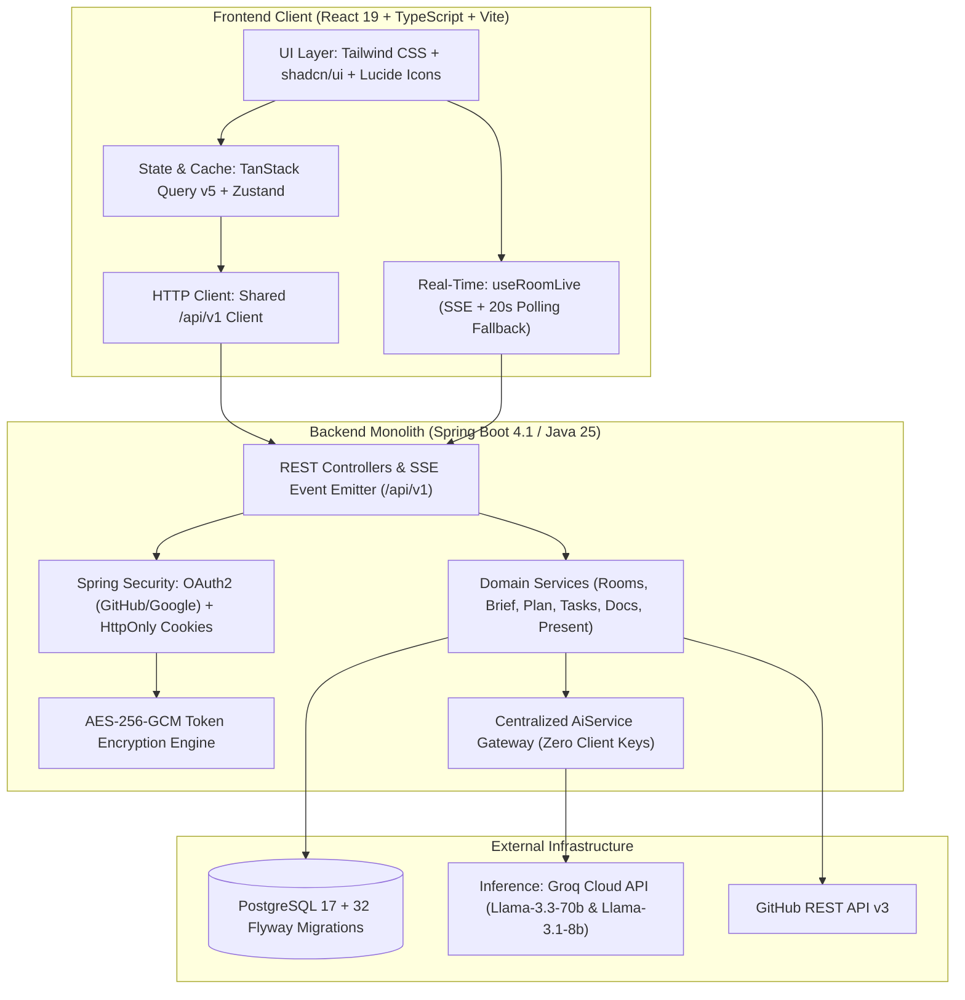

# Hackathon OS: Complete Project Context & System Reference

> **Document Status:** Authoritative project context dossier.  
> **Target Audience:** Product design AI agent tasked with creating the marketing & landing page.  
> **Source of Truth Rule:** The actual application source code and migrations take precedence over early planning documentation. Discrepancies between initial design docs and production code are explicitly highlighted throughout this document.  
> **Security Guarantee:** Contains zero secrets, passwords, API tokens, or `.env` credential values.

---

## Confidence Label Guide
- **`[Verified in code]`**: Directly confirmed by inspecting frontend components, backend Java controllers, services, database schemas/Flyway migrations, or configuration files.
- **`[From docs]`**: Found in repository documentation (`docs/problem.md`, `docs/ideation.md`, `docs/tech_stack.md`, `docs/WORK_LOG.md`, etc.), reflecting historical intent or design principles.
- **`[Inferred]`**: Logical product deduction based on combined code architecture and documentation context.
- **`[UNCLEAR]`**: Open ambiguity requiring explicit confirmation from the founder.

---

## 1. Project Snapshot

- **Project Name:** Hackathon OS `[Verified in code]` (`frontend/src/shared/constants/copy.ts`)
- **One-Sentence Description:** Hackathon OS is an opinionated execution operating system and real-time team-room platform that carries hackathon teams step-by-step from raw problem statement intake to a complete, rehearsed, and verified submission before the clock expires. `[Verified in code]` (`README.md`)
- **3-4 Sentence Elevator Pitch:**  
  Most hackathon teams do not lose because they lack coding talent—they lose because of poor sequencing, runaway scope, unread rubrics, and rushing a broken demo in the final minutes. Hackathon OS acts as a structured command center for the entire 24–48 hour sprint, enforcing critical checkpoints (rules confirmation, silent ideation, AI-guided planning, Kanban execution, MVP reality tracking, pitch rehearsal, and submission verification). Backed by real-time Server-Sent Events (SSE) and an automated backend AI gateway with zero client-side keys, it ensures teams spend their finite hours building the right slice of product and pitching it effectively. `[Verified in code & docs]`
- **Current Operational Status:**  
  Fully working local full-stack application `[Verified in code]`. Docker Compose multi-container stack, Spring Boot 4.1 / Java 25 backend monolith, PostgreSQL 17 database with 32 Flyway migrations, and React 19 + Vite frontend with real-time SSE live synchronization, Groq Llama-3.3-70B AI integration, GitHub account linking, and comprehensive Playwright end-to-end test coverage.
- **Platform Type:**  
  Web Application (Single-Page Application in React 19 + TypeScript, installable as a Progressive Web App (PWA) with offline caching and static export). `[Verified in code]`

---

## 2. The Problem and the Audience

### 2.1 The Core Problem `[From docs: docs/problem.md & docs/ideation.md]`
Hackathon participants face extreme time pressure (typically 24 to 48 hours). In that compressed window, teams must make dozens of high-stakes decisions: understanding complex rules, selecting ideas, defining tech stacks, dividing roles, managing git branches, preparing pitch slides, recording demo videos, and filling submission forms.

**Why teams actually lose (Research synthesis in `docs/problem.md`):**
1. **Out-sequenced, not out-coded:** Teams waste the first 6–10 hours debating tech or pursuing ungrounded ideas. By the time a basic skeleton runs, there is zero time left for testing, rehearsal, or polishing.
2. **Overscoping ("Feature-itis"):** Teams attempt a multi-feature "platform" and end up with five half-broken paths and no single end-to-end working flow at judging time.
3. **Unread rubrics & rule eliminations:** Up to 12 distinct non-quality disqualifications occur (wrong team composition, missing mandatory demo video, single-commit repos, unlinked code, wrong track submission).
4. **Judging realities:** Judges see dozens of demos under fatigue. Rubric scores compress; judges reward projects with a clear 30-second explanation, an end-to-end working flow, and a team that can defend what was actually built vs. mocked.
5. **Tool fatigue:** Using separate tools (Discord, WhatsApp, Notion, Jira, Google Docs, Trello, Figma) creates fragmented context and overhead that drains hours.

### 2.2 Target Audience `[From docs & Inferred]`
- **Primary Audience:** Student hackathon teams (especially participants in large competitions like Smart India Hackathon [SIH], Major League Hacking [MLH], Devpost-hosted events, and collegiate hackathons).
- **Secondary Audience:** Working professionals in corporate/internal hackathons, weekend indie hackers, and solo developers executing time-boxed AI sprints.
- **Future/Tertiary Audience:** Hackathon organizers and university mentors seeking visibility into team progress and checkpoint status. `[From docs: ideation.md F22; code currently has read-only Mentor view]`

### 2.3 How Teams Solve This Today `[From docs: docs/problem.md §8]`
- **Ad-hoc group chats:** WhatsApp, Telegram, or Discord channels where links, tasks, and ideas are buried in message noise.
- **Generic task trackers:** Jira, Linear, or Trello—which teams abandon quickly because configuring boards and tickets wastes precious sprint hours.
- **Scattered documents:** Google Docs or Notion for PRDs, Google Slides or Canva for decks, and improvised local spreadsheets.
- **Result:** No shared clock, no rubric-driven forcing functions, uncoordinated git branches, and last-minute submission panic.

---

## 3. What the Product Actually Does (Verified in Code)

The product is organized into focused workspaces accessible via the room sidebar. Below is the complete catalog of working features verified in the codebase:

```
ROOM LIFECYCLE (Sidebar Navigation Hierarchy)
├── Overview (Room Dashboard, Stat Strip, Clock, Checkpoints, Attention Items)
├── Brief (Statement Intake, Vision OCR, Rules Extraction, Rubric Weights, Leader Confirmation)
├── Team (Roster, Role Assignments, Skill-Gap Meter, Team Charter)
├── Ideate (Silent Solo Storming, Card Reveal, AI Stress Test, Voting, Lock Decision)
├── Plan (4-Step Guided Generator: PRD, Tech Stack, Phases, Demo Script → 9 Docs Vault)
├── Docs (Markdown Vault, Version History, Live Preview, Conflict Resolution, ZIP Export)
├── Board (Phase-Driven Kanban Board, Task Dependencies, Swimlanes, Leader Approvals)
├── MVP Studio (Core Flow, Reality Ledger, Pitch Card, "What Breaks First" Defense, Pre-flight Health)
├── Tech Studios
│   ├── GitHub (OAuth Account Linking, Branch Map with Roles, Commit Activity, Demo Freeze Tag)
│   ├── APIs (Contract-First Catalog, Mock Responses, External Fallbacks, OpenAPI Spec / Swagger UI)
│   └── Diagrams (Mermaid Editor & Preview, Template Gallery, Roundtrip Docs Sync)
├── Present Group
│   ├── Deck (Canva, PowerPoint .pptx Upload, Google Slides Embed, CUE Teleprompter, Health Sidebar)
│   ├── Pitch Kit (Demo Proof of Work & Vault, Pitch Wizard with Live Mic Waveform, Q&A Judge's Chair)
│   └── Submission (Launch Pad, Flight Countdown, Leader Sign-off, Red Stamp, Summary Timeline, Reopen)
└── Review & Portfolio
    ├── Readiness (Six Readiness Rings, Weak Spots Detector, Judge Simulator)
    ├── Summary & Retro (Timeline Milestones, Stats, Reflection Prompts)
    └── Builder Passport / Portfolio (Public /u/:username, Activity Heatmap, Role Fingerprint)
```

### 3.1 Room Setup, Onboarding & Playbooks `[Verified in code]`
- **Situation Picker (`/app/situation`):** Routes users based on their immediate state: "Event hasn't started" (Prep mode), "Event is live" (Speed mode), or "Just exploring" (Playbooks directory).
- **Room Creation Wizard (`/app/create-room`):** Configures room name, duration, scheduled starts, and event templates. Includes an AI sparkle button (`/api/v1/rooms/suggest-name`) that generates creative hackathon project names using the backend fast LLM.
- **Event Templates / Playbooks (`/playbooks` & `/app/playbooks`):** Pre-configured blueprints for major event styles:
  - `pb-sih`: Smart India Hackathon (36-hour sprint, strict team of 6, PPT internal round).
  - `pb-devpost`: 48-hour online hackathon (teams of 1–4, asynchronous video judging).
  - `pb-mlh`: Major League Hacking 36-hour weekend sprint.
  - `pb-sprint`: 4-hour rapid generative AI sprint.
  - `pb-corporate`: 24-hour enterprise internal innovation hackathon.
  - `pb-solo`: 24-hour solo builder sprint.
- **Tool Directory (`/app/tools`):** Curated database of vetted hackathon tools across 6 categories (Recording, Video, Diagrams, Design, API, Deployment) with verified open-source/freemium licenses, "zero affiliate links", and "last-checked" verification dates.

### 3.2 Brief Intake & Rules Engine `[Verified in code]`
- **Multimodal Intake (`/app/room/:id/brief`):** Accepts raw text paste or direct upload of 1 PDF or up to 5 images. Calls backend vision OCR (`POST /api/v1/rooms/{id}/brief/source/images`) to extract problem statement text.
- **Rule & Rubric Extraction:** Parses statement text into structured categories: Target Audience, Judging Rubric (criteria + numerical percentage weights), Deadlines, Allowed/Forbidden Tech Rules, Team Eligibility Constraints, AI Policy, Required Deliverables, and Tracks & Sponsor Prizes.
- **Mandatory Leader Confirmation Gate:** Every extracted rule and rubric weight requires an explicit toggle check by the room leader before the brief can be confirmed (`POST /api/v1/rooms/{id}/brief/confirm`). Blocks advancement if mandatory criteria are unconfirmed.

### 3.3 Team Room & Roles `[Verified in code]`
- **Roster & Invite Management (`/app/room/:id/team`):** Manage members with shareable 4-character join codes and unique tokenized invite links (`/invite/:token`).
- **Role Tags:** Assign team members to distinct operational roles: `Leader`, `Builder`, `Designer`, `Presenter`, `Domain Expert`, and `QA`.
- **Skill-Gap Meter:** Visual radar assessing whether the team covers essential hackathon disciplines (Frontend, Backend, ML/AI, Design, Pitch, Domain, QA). Flags blind spots early.
- **Team Charter:** 5-minute alignment module capturing member availability hours, goal alignment (Win vs. Learn vs. Portfolio), and feedback norms to prevent interpersonal friction.

### 3.4 Ideation Board `[Verified in code]`
- **Silent Solo Round:** Team members post idea cards privately with optional anonymity to avoid loud-voice anchoring.
- **Card Anatomy:** Captures one-sentence identity ("Tool that does X for Y"), problem statement, target persona, core user flow (3–5 steps), "wow moment", and riskiest assumption. Supports attached links and research notes.
- **Critique & Voting:** Card reveal, structured critique ratings, and anonymous upvoting.
- **AI Stress Test:** Evaluates shortlisted ideas against the confirmed brief rubric, finishability within the remaining time, technical feasibility, and differentiation vs. obvious AI wrappers.
- **Decision Lock & "Before We Plan" Gate:** Leader locks the primary approved idea. Flyway migration V10 enforces a pre-planning checkpoint where the team reviews approved ideas and captures notes before generating the plan.

### 3.5 Plan Generator & Docs Vault `[Verified in code]`
- **4-Step Plan Pipeline (`/app/room/:id/plan`):**
  1. *PRD & MVP Scope:* Product requirements, user journey, and minimal testable scope.
  2. *Tech Stack & Architecture:* Frontend, backend, database, and third-party services matched to team skills.
  3. *Phases & Design:* Time-budgeted checkpoints and design system tokens.
  4. *Demo Script & Q&A:* 90-second pitch narrative and anticipated judge grilling points.
- **Dual Execution Modes:**
  - *Automated Backend Generation:* Calls backend `AiService` / `GroqClient` (`POST /api/v1/plan/steps/{stepKey}/generate`) with dynamic context injection (brief text, approved ideas, member skills, available hours).
  - *Prompt Bridge Fallback:* Generates ready-to-copy prompts that can be pasted into any external chat (ChatGPT, Claude, Gemini) and validated back into the system via text paste or multipart file upload.
- **Docs Vault (`/app/room/:id/docs`):** Automatically creates 9 versioned Markdown files:
  `PRD.md`, `PROBLEM.md`, `TECH_STACK.md`, `PHASES.md`, `MVP.md`, `CUT_LIST.md`, `RISKS.md`, `DEMO_SCRIPT.md`, and `DECISIONS.md`.
  Features split-pane viewing, Markdown editing, diff history, comment threads, optimistic concurrency conflict detection, and one-click ZIP export.

### 3.6 Phase-Driven Kanban Board `[Verified in code]`
- **Dynamic Task Engine (`/app/room/:id/board`):** Automatically seeded with tasks mapped to room phases (P1, P2, P3, etc.) upon exiting the planning stage.
- **Columns & Views:** Standard Kanban columns (`Todo`, `In Progress`, `In Review`, `Done`) plus switchable list view and swimlanes grouped by Assignee, Priority, or Phase.
- **Task Dependencies (Flyway V18):** Enforces prerequisites so downstream tasks cannot be started until blocker tasks are completed.
- **Leader Confirmation Gate:** Tasks can be flagged as requiring leader sign-off before being moved to Done.
- **"I'm Blocked" Mechanism:** One-tap blocker alert that immediately surfaces on the leader's dashboard and triggers toast notifications.
- **Gamification & Feedback:** Sound effects (`playSound('success')`) and confetti celebrations on task completion.

### 3.7 MVP Studio `[Verified in code]`
- **MVP Command Center (`/app/room/:id/mvp`):** Dedicated page focused strictly on demo viability.
- **One-Sentence Identity & Wow Moment:** Explicitly displays the core pitch hook that judges must experience in the first 60 seconds.
- **3-5 Step Core Flow:** Step-by-step definition of the exact end-to-end user path demonstrated in the pitch.
- **Reality Ledger:** Strict categorization of every component: *Built this weekend*, *Existing library/API*, *Mocked*, or *Planned*. Gives the team an honest, rehearsed answer to the judge's question: "What did you actually build this weekend?"
- **"What Breaks First" Defense:** Pre-drafted admissions of technical weaknesses and planned mitigations, turning potential demo flaws into credibility points.
- **Pre-flight Health Checklist:** Verifies offline viability, cached API fallbacks, backup screenshots, and demo script alignment.

### 3.8 Technical Studios (GitHub, API Hub, Diagrams) `[Verified in code]`
- **GitHub Hub (`/app/room/:id/github`):**
  - OAuth account linking (`/api/v1/github/link/start`) with AES-256-GCM encrypted token storage.
  - Interactive repo selector and branch map.
  - Branch purpose annotations and role assignments (`main`, `demo-safe`, `feature`, `experiment`).
  - Pre-event commit analyzer: flags commits made prior to official kickoff (preventing disqualification under pre-existing work rules).
  - Freeze Demo Tag: one-click freeze of a clean commit tag for live demo safety.
- **API Hub (`/app/room/:id/apis`):**
  - Contract-first API workspace for frontend/backend parallel execution.
  - External API catalog tracking base URLs, auth types, rate limits, status (UP/DOWN), and fallback strategies (Mocked, Cached, Static).
  - Internal REST endpoints manager with request/response JSON schemas, mock responses, and Swagger UI integration.
  - OpenAPI 3.x spec import and export.
- **Diagram Studio (`/app/room/:id/diagrams`):**
  - Built-in Mermaid editor with live SVG rendering and export (SVG/PNG/Code).
  - Starter templates: System Architecture, User Flow, Database ERD, Sequence Diagram, and Roadmap.
  - Bidirectional roundtrip sync: editing a diagram updates the Mermaid block inside `ARCHITECTURE.md` in Docs Vault.

### 3.9 PRESENT Group (Deck, Pitch Kit, Submission) `[Verified in code]`
- **Deck Page (`/app/room/:id/deck`):**
  - *State A:* Provider selector for Canva, Google Slides (embed link), or PowerPoint (.pptx file upload).
  - *State B:* Embedded 16:9 presentation stage with orange glow, slide filmstrip, CUE teleprompter notes, and Deck Health sidebar (rubric coverage bars, presentation lint chips, rehearsal counter).
- **Pitch Kit (`/app/room/:id/pitch-kit`):**
  - *Demo Proof of Work:* Vault links (Full video, 60s backup video, live URL), shot grid, and insurance pills (Works offline, Cached responses, Screenshots ready, Mobile hotspot, Backup charger).
  - *Pitch Rehearsal Stage:* Run-of-show timeline, slide script cards, teleprompter, and live microphone audio input with real-time audio waveform visualizer (`AudioContext` / `AnalyserNode`) and rehearsal counter.
  - *Q&A "Judge's Chair":* Generates anticipated judge grill questions with difficulty ratings (1–3), risk points, and "why asked" explanations. Includes interactive practice mode.
- **Submission Center (`/app/room/:id/submission`):**
  - *State A (Launch Pad):* Real-time countdown to deadline, submission instructions, and leader-only "Mark as Submitted" confirmation dialog with sound effects.
  - *State B (Submitted Close-out):* Large red-ink `SUBMITTED` stamp, full timeline milestone log (creation → brief → plan → build → first task → submission), room statistics, and leader option to reopen submission if revisions are needed.

### 3.10 Review, Portfolio & System Architecture `[Verified in code]`
- **Readiness Score (`/app/room/:id/readiness`):** Six animated SVG progress rings (Rubric coverage, MVP health, Demo rehearsal, Pitch deck, Submission checklist, Fallback insurance), weak spots list, and AI Judge Simulator.
- **Room Summary & Retrospective (`/app/room/:id/summary` & `/retro`):** Post-event milestone timeline, completed task metrics, team contribution breakdown, and continuation vs. archive recommendations.
- **Builder Passport / Portfolio (`/u/:username` & `/app/portfolio`):** Public builder showcase featuring project case studies, hackathon stamps, GitHub-style contribution heatmap, role fingerprint radar, and resume export.
- **Mentor View (`/mentor/:token`):** Public read-only access link allowing mentors to inspect room brief, architecture, and board status in 60 seconds and submit structured advice.
- **System Pages (`/403`, `/404`, `/500`, `/offline`, `/maintenance`):** Dedicated error, offline banner, and maintenance handling.

---

## 4. User Journey and Key Flows

```mermaid
sequenceDiagram
    autonumber
    actor Team as Team Leader & Members
    participant Landing as Landing Page (/)
    participant Auth as OAuth Login (/signin)
    participant Setup as Room Setup (/app/create-room)
    participant Brief as Brief Intake (/brief)
    participant Ideate as Ideation Board (/ideate)
    participant Plan as Plan Generator (/plan)
    participant Build as Build Studios (/board, /docs, /mvp, /github)
    participant Present as Present Stage (/deck, /pitch-kit, /submission)
    participant Close as Archive & Portfolio (/u/:username)

    Team->>Landing: 1. Visit landing page & click "Start a room"
    Landing->>Auth: 2. Sign in via GitHub or Google (HttpOnly session)
    Auth->>Setup: 3. Pick situation & event template (e.g. SIH 36h)
    Setup->>Brief: 4. Upload statement PDF/images; AI extracts rules & rubric
    Note over Brief: Leader confirms rubric weights & rules checklist
    Brief->>Ideate: 5. Silent ideation round, voting, AI stress test
    Note over Ideate: Leader approves winning idea card & enters pre-plan notes
    Ideate->>Plan: 6. Run 4-step AI plan generator
    Plan->>Build: 7. Enter Build Phase (seeds 9 docs, 38 tasks, phases)
    Note over Build: Team executes Kanban sprint, logs MVP reality, links GitHub
    Build->>Present: 8. Feature freeze: rehearse pitch with audio waveform, link deck
    Present->>Present: 9. External submission verified; Leader marks room submitted
    Present->>Close: 10. Room archived; Builder passport & portfolio updated
```

### Flow Breakdown
1. **First Touch & Sign In:**  
   User lands on `/`, reviews playbooks and five losing causes, clicks "Start a room". Authenticates via GitHub or Google OAuth. Session is stored in a secure server-side `HttpOnly` cookie.
2. **Room Creation:**  
   User chooses situation (Prep vs. Speed mode), picks an event template (e.g., SIH 36-hour), clicks AI sparkle button for a generated team name, and creates the room. Team members join via short join code or shareable link.
3. **Brief Intake & Confirmation:**  
   Leader uploads hackathon problem PDF/images. Vision OCR parses rules and rubric. Leader ticks mandatory checkboxes to lock criteria and deadlines into the system clock.
4. **Ideate & Gate:**  
   Team members write cards during silent solo storming. Cards reveal; team upvotes; AI runs stress tests against finishability. Leader approves the primary idea. "Before We Plan" gate collects final strategy notes.
5. **Plan Generation:**  
   The system runs the 4-step pipeline (PRD/MVP, Tech Stack, Phases/Design, Demo Script/Q&A). Generates 9 versioned documents in Docs Vault and seeds the Kanban board with ~38 role-assigned tasks.
6. **Sprint Building:**  
   Team works on the Kanban board with dependency enforcement. GitHub repo is linked, branch roles set, and pre-event commits audited. API contracts and Mermaid diagrams are created and synced. MVP Studio tracks what is real vs. mocked.
7. **Pitch Preparation:**  
   At feature freeze, the team embeds their Canva, Google Slides, or PowerPoint deck. In Pitch Kit, they rehearse the pitch with live audio waveform analysis and drill against simulated judge questions.
8. **Submission & Close-out:**  
   Leader follows the pre-flight checklist, verifies external submission on Devpost/Devfolio, and clicks "Mark as Submitted" on the Launch Pad. A red `SUBMITTED` stamp seals the room timeline, unlocking the retrospective and Builder Passport.

---

## 5. Evolution of the Idea (Docs vs. Actual Code)

The project started with research in `docs/problem.md` (19 Sep 2026) and evolved substantially through implementation. The marketing landing page MUST reflect the code reality rather than discarded documentation concepts.

| Topic / Feature | Early Docs Concept (`docs/ideation.md`, `tech_stack.md`) | Actual Code Reality (`[Verified in code]`) | Why It Changed / Impact on Landing Page |
|---|---|---|---|
| **AI Architecture** | **Prompt Bridge only** on free tier: users had to manually copy-paste prompts into ChatGPT/Claude because API costs were assumed prohibitive. BYOK (paste personal API key in frontend) planned. | **Zero Client Keys Gateway:** All AI is centralized in backend `AiService` / `GroqClient` (Llama-3.3-70B & 8B). Frontend key entry was completely stripped. Automatic AI generation is live for brief extraction, plan generation, naming, and Q&A. Prompt Bridge is kept as a manual fallback. | Major landing page selling point! Users get native one-click AI generation without managing API keys or paying provider bills. |
| **PRESENT Tools** | Planned as 5 separate, disconnected tools: Deck, Demo Studio, Pitch Studio, Rehearsal Mode, Q&A Studio. | **Consolidated 3-Route PRESENT Group:** Collapsed into `Deck` (`/deck`), `Pitch Kit` (`/pitch-kit` unifying demo vault, pitch teleprompter with live mic waveform, and judge grill), and `Submission` (`/submission`). | Cleaner, faster user experience. Reduces navigation clicks when the clock is ticking down. |
| **Submission Screen** | `docs/WORK_LOG.md` mentioned 5 editable write-up cards and flight-path breadcrumbs on `/submission`. | **Two-State Launch Pad:** `/submission` renders State A (countdown, submission guidance, leader confirmation dialog) and State B (red-ink `SUBMITTED` stamp, full timeline audit, room stats, reopen action). | Clearer psychological boundary: Hackathon OS does not pretend to submit to external portals; it acts as the team's flight-check and verified archive. |
| **Billing & Payments** | Discussed as active Pro subscriptions with paid tiers. | **Waitlist Interest Model:** Configuration (`plans.json`) defines Free ($0), Pro ($9), and Max ($19), but `paymentsEnabled: false` and `BILLING_ENFORCE: false` in dev. Clicking upgrade opens a waitlist dialog and logs interest to PostgreSQL `plan_interest`. | Do NOT advertise live credit card checkouts or paid subscriptions. Position as Free with upcoming Pro waitlist. |
| **Real-time Engine** | Early tech stack suggested WebSockets/STOMP. | **SSE + Polling Fallback:** Built on lightweight Server-Sent Events (`/api/v1/rooms/{roomId}/live`) with 20-second polling fallback, presence heartbeats, and optimistic locking. | Simpler, highly resilient over venue Wi-Fi and mobile hotspots. |
| **Live Cursor Presence** | Considered real-time collaborative typing via Yjs. | **Document Versioning & Conflict Detection:** Deliberately scoped out character-by-character cursors. Uses chunked edits, version history, and conflict banners. | Avoids complex synchronization bugs during high-stress sprint conditions. |
| **Native Video Transcoding** | Ideated video tools for rendering promo videos. | **Metadata & Links Only:** Tracks recording URLs, checks video duration constraints, and provides insurance checklists. Zero server-side video rendering. | Explicit non-goal to avoid GPU infrastructure costs and failures. |

---

## 6. Tech Stack and Architecture



### 6.1 Frontend Stack `[Verified in code]`
- **Framework & Language:** React 19, TypeScript (strict mode), Vite.
- **Styling & Design System:** Tailwind CSS v4, shadcn/ui primitives, Radix UI headless components, Lucide icons.
- **Server State & Caching:** TanStack Query (React Query) v5 with aggressive client-side caching and offline fallback storage in `localStorage`.
- **Client State:** Zustand (for transient UI state, layout drawers, and diagram drafts).
- **Routing:** React Router DOM v7 (pinned in `AGENTS.md`; code-split via `React.lazy` and `Suspense`).
- **Markdown & Diagrams:** `react-markdown` with sanitizers (`rehype-sanitize`), CodeMirror/TipTap editors, and client-side `mermaid` SVG renderer.
- **Audio Processing:** Native Web Audio API (`AudioContext`, `AnalyserNode`) for live microphone input waveform visualization during pitch rehearsal.
- **Testing:** Playwright for end-to-end browser testing, Vitest for unit testing, MSW (Mock Service Worker) for network mocking.

### 6.2 Backend Stack `[Verified in code]`
- **Framework & Runtime:** Spring Boot 4.1.x running on Java 25 (LTS) with Virtual Threads enabled.
- **Architecture Pattern:** Modular Monolith with 47 distinct domain packages (`rooms`, `brief`, `ideas`, `plan`, `tasks`, `docs`, `github`, `apihub`, `diagrams`, `pitch`, `deck`, `demo`, `submission`, `readiness`, `billing`, `portfolio`, etc.).
- **Database & Migrations:** PostgreSQL 17 with Flyway migration management (32 migration scripts from V1 to V32). Extensive use of JSONB for flexible plan documents, rubric items, and rehearsal telemetry.
- **Data Access:** Spring Data JPA (Hibernate) with `JdbcClient` for optimized batch operations.
- **Security:** Spring Security with OAuth2 login (GitHub and Google). Server-side sessions using `JSESSIONID` stored in secure `HttpOnly`, `SameSite=Lax` cookies. User OAuth tokens encrypted at rest via AES-256-GCM using `APP_SECURITY_ENCRYPTION_KEY`.
- **Real-Time Streaming:** Server-Sent Events (SSE) via `SseEmitter` with event broadcast on entity modifications and 20-second heartbeat polling fallback.

### 6.3 Technical Credibility & Impressive Points (For Landing Page)
1. **Rule 13 Zero Client Keys Architecture:** Unlike typical AI wrappers that demand users paste private API keys into browser local storage, Hackathon OS routes all inference through an isolated server-side gateway. No API keys ever leak to the browser.
2. **Deterministic Resiliency on Bad Venue Wi-Fi:** Built from day one for chaotic venue conditions: offline banner detection, `localStorage` doc/task snapshotting, SSE with exponential backoff reconnect, and zero-dependency ZIP room exports.
3. **Optimistic Locking & Concurrency Protection:** Multi-user editing protected by entity versioning and conflict detection banners (`ConflictBanner`), preventing team members from silently overwriting each other's code or docs.
4. **Sub-second Groq Llama-3.3-70B Pipeline:** Generates comprehensive multi-page PRDs, tech architecture reviews, and 38-task Kanban backlogs in seconds.

---

## 7. Business Model and Access

### 7.1 Tier Structure `[Verified in code: backend/src/main/resources/config/plans.json]`

| Plan Name | Price | Room Quota | Feature Inclusions (from `plans.json`) | Status in Code |
|---|---|---|---|---|
| **Free** | **$0** / month | **3 rooms** per month | Brief intake, Ideate, Plan, Board, MVP Studio, Docs vault, Tech studios, Pitch kit, Submission launch pad, ZIP export, Playbooks, and Tool directory. | **Active & Default** |
| **Pro** | **$9** / month | **25 rooms** per month | Everything in Free + Claude MCP access (planned), Post-hackathon continuation support (planned), higher AI rate limits, priority support. | **Waitlist Only** |
| **Max** | **$19** / month | **Unlimited** rooms | Everything in Pro + Review, Retro, and Project Summary pages, GitHub visual branch map. | **Waitlist Only** |

### 7.2 Current Monetization State `[Verified in code]`
- **Payments Disabled:** `paymentsEnabled: false` in `plans.json`. No live Stripe checkout or credit card collection exists in the codebase.
- **Billing Enforcement:** The backend contains enforcement logic (`checkCanCreateRoom`, `checkCanAccessReviewPages`), but `BILLING_ENFORCE` defaults to `false` in development.
- **Waitlist Capture:** Clicking "Join the waitlist" in `/app/settings/billing` opens a dialog prompting the user for an optional note (e.g., "Hoping to use for collegiate hackathons"), which is persisted in the PostgreSQL `plan_interest` table (`POST /api/v1/billing/interest`).
- **Signup Requirements:** Free OAuth sign-in via GitHub or Google. No credit card required.

---

## 8. Brand and Design Inputs

### 8.1 Name, Logo & Tagline `[Verified in code]`
- **Brand Name:** `Hackathon OS` (`frontend/src/shared/constants/copy.ts:90`)
- **Logo Representation:** Text logo `Hackathon OS` (`font-display` serif or `font-bold` UI) with single-letter monogram `H` in spinner loader.
- **Tagline / Hero Hook Options (Derived from code/copy):**
  - *"An opinionated execution operating system and real-time team-room platform for hackathons."* (`README.md`)
  - *"Five ways teams lose: no demo running by the halfway point, scope larger than the clock, rubric never read, submission started last, no fallback if wifi fails."* (`frontend/src/shared/constants/copy.ts:22-44`)
  - *"Vetted tools for hackathon teams. Zero affiliate links, zero sponsored slots. Updated weekly."* (`frontend/src/features/tools/tool-directory-view.tsx:97`)

### 8.2 Color Palette (Design Tokens) `[Verified in code: frontend/src/index.css & tokens.css]`

```css
/* Core Palette Tokens (Light Theme Default) */
--shell:             #F5F5F5;  /* Main application backdrop / page canvas */
--surface:           #FBFBFB;  /* Secondary panel surface */
--card:              #FFFFFF;  /* Card surface */
--border:            #EAEAEA;  /* Standard hairline divider */
--border-strong:     #DADADA;  /* Emphasized borders & inputs */
--hover:             #EFEFEF;  /* Hover state */
--active:            #EBEBEB;  /* Active / pressed state */
--ink:               #0A0A0A;  /* Primary typography / strong black */
--ink-2:             #737373;  /* Muted secondary typography */
--ink-3:             #A3A3A3;  /* Tertiary / placeholder text */

/* Accent & Status Colors */
--brand-from:        #6D5EF5;  /* Violet brand gradient start */
--brand-to:          #9B8CFF;  /* Violet brand gradient end */
--bg-accent:         #F0B04A;  /* Warm amber accent */
--success-bg:        #DDF7DA;  --success-fg: #16820F; /* Green success */
--warn-bg:           #FEF1D6;  --warn-fg:    #A15C07; /* Amber warning */
--danger:            #E5484D;  /* Red destructive / deadline */

/* Stage Theme Tokens (PRESENT Group Palette) */
--stage-ink:         #0E0E10;
--stage-dark-card:   #151517;
--stage-sun:         #FDE781;
--stage-orange:      #FF7A1A;
--stage-pink:        #FCC4E0;
--stage-lilac:       #C4C5FC;
--stage-mint:        #A5EFBE;
--stage-sky:         #B7D9FF;

/* Category Tints (Tools & Tags) */
--cat-recording:     #FDE8E8 (bg) / #C93B3B (fg)
--cat-video:         #EDE9FE (bg) / #6D4FD8 (fg)
--cat-diagrams:      #D9F3F4 (bg) / #0E7C86 (fg)
--cat-design:        #FDE9DA (bg) / #B4531A (fg)
--cat-api:           #DCEBFE (bg) / #2457C5 (fg)
--cat-deployment:    #E4E7EC (bg) / #3F4A5A (fg)
```

### 8.3 Typography `[Verified in code]`
- **Display / Editorial Font:** `'Instrument Serif', Georgia, serif` (used for major page headers, stage intros, hero typography, and the "Have you submitted?" launch pad).
- **UI / Body Font:** `'Inter Variable', -apple-system, BlinkMacSystemFont, 'Segoe UI', Roboto, sans-serif` (used for clean, readable app controls, lists, and tables).
- **Code & Monospace Font:** `'JetBrains Mono Variable', 'JetBrains Mono', monospace` (used for task keys, countdown clocks, rate limit badges, git hashes, and timestamps).

### 8.4 Tone of Voice & Copy Rules `[Verified in code: frontend/src/shared/constants/copy.ts]`
- **Voice Principles:** Direct, calm, specific, short sentences. No hype.
- **Strictly Banned Words:**  
  ❌ `seamless`  
  ❌ `unleash`  
  ❌ `supercharge`  
  ❌ `elevate`  
  ❌ `effortless`  
  ❌ `"let's get started!"`
- **Existing Verbatim Copy Worth Reusing:**
  - *"Most teams don't lose because they can't code. They lose because they decide late, scope wrong, and run out of time."* (`docs/problem.md`)
  - *"Five ways teams lose: 1. No demo running by the halfway point. 2. Scope larger than the clock. 3. Rubric never read. 4. Submission started last. 5. No fallback if wifi fails."* (`frontend/src/shared/constants/copy.ts:22-44`)
  - *"Submit your project on the event's own platform. When that's done, mark it here to close out this room."* (`frontend/src/features/submission/components/submission-state-a.tsx:84`)
  - *"One view of where the team stands before the judges arrive."* (`frontend/src/features/readiness/readiness-page.tsx:82`)
  - *"Vetted tools for hackathon teams. Zero affiliate links, zero sponsored slots. Updated weekly."* (`frontend/src/features/tools/tool-directory-view.tsx:97`)
  - *"What did you build this weekend? An honest answer prepared in advance."* (`frontend/src/features/mvp/components/mvp-reality-ledger.tsx`)

---

## 9. Landing Page Raw Material (Critical for Design Chat)

### 9.1 Candidate Value Propositions & Headline Angles
1. **The Anti-Failure Angle (Direct & Empirical):**  
   *Headline:* Stop losing hackathons to bad sequencing.  
   *Subhead:* Hackathon OS keeps your team focused on the clock, the rubric, and a working demo—from kickoff to the final pitch.
2. **The "Jira is for Work, This is for Sprints" Angle:**  
   *Headline:* Not a ticket tracker. An execution system for 36-hour builds.  
   *Subhead:* Jira tracks tasks for quarters. Hackathon OS enforces checkpoints, scopes your MVP, syncs your branches, and rehearses your pitch before time runs out.
3. **The Judge-Centric Angle:**  
   *Headline:* Build the project judges actually reward.  
   *Subhead:* Judges see 50 broken demos a day. Hackathon OS guarantees an end-to-end working flow, a rehearsed pitch, and clear proof of what you actually built this weekend.

### 9.2 Key Differentiators vs. Alternatives

| Alternative | What They Offer | Where They Fail in Hackathons | How Hackathon OS Wins |
|---|---|---|---|
| **WhatsApp / Discord** | Free-form team chat | Context gets lost; no concept of time, scope, or checkpoints; silent blockers. | Structured room with real-time SSE updates, "I'm blocked" alerts, and automatic clock sync. |
| **Jira / Linear / Trello** | General-purpose ticket tracking | Heavy setup overhead; no brief ingestion; no rubric awareness; ignores pitch and demo. | Zero setup; templates tailored to SIH/MLH/Devpost; built-in pitch kit, reality ledger, and demo freeze. |
| **Notion / Google Docs** | Free-form documentation | Blank page paralysis; documents drift from code; no automated planning or task generation. | Auto-generates 9 structured markdown project files from approved ideas in under 2 minutes. |
| **Raw AI Chat (ChatGPT/Claude)** | Generic code generation | Generates disjointed code nobody understands; leads to Q&A collapse at judging time. | Centralized AI gateway with Llama-3.3-70B that enforces rubric constraints, scopes tasks, and drills the team on their own build. |

### 9.3 Feature-to-Benefit Mapping

| Feature in Code | What the User Actually Gains |
|---|---|
| **Brief Intake with Vision OCR & Mandatory Confirmation** | Prevents disqualification from missed eligibility rules, hidden deliverable requirements, or unread rubric criteria. |
| **Silent Ideation & AI Stress Test** | Eliminates loud-voice bias, stops 4-hour stack debates, and flags overly complex ideas before a single line of code is written. |
| **Automated 4-Step Plan Generator** | Turns raw ideas into a complete PRD, tech architecture, and 38-task Kanban board in 90 seconds. |
| **Reality Ledger (MVP Studio)** | Prepares the team to confidently answer "What did you build this weekend vs. what is a library?" without fumbling before judges. |
| **GitHub Pre-Event Commit & Role Analyzer** | Protects the team from disqualification for pre-built code; freezes a safe demo tag before the presentation. |
| **API Hub with Mock Responses** | Allows frontend and backend engineers to build in parallel from hour 1 without waiting on live endpoints. |
| **Pitch Rehearsal with Live Mic Waveform** | Forces the team to time their presentation out loud, eliminating overrunning pitches and split-attention demos. |
| **Q&A "Judge's Chair" with Grill Levels** | Prepares builders for aggressive technical scrutiny so they can defend their code with confidence. |
| **Launch Pad & Submitted Stamp** | Ensures the team starts the submission with ample buffer time, avoiding last-second portal crashes. |
| **Builder Passport & Portfolio** | Automatically transforms completed hackathons into verified, shareable project case studies on `/u/:username`. |

### 9.4 Likely Objections and Honest FAQs

- **Q: Does Hackathon OS write all my code for me?**  
  *A:* No. Hackathon OS is an execution operating system, not an autonomous coding agent. It scaffolds your PRD, defines your API contracts, creates your Mermaid architecture, generates your tasks, and structures your pitch. You write and own your code.
- **Q: Why should we use this instead of our existing Discord or WhatsApp group?**  
  *A:* Keep your group chat for banter! Hackathon OS replaces the messy spreadsheets, unread rule PDFs, and scattered Notion docs with a single clock-aware command center that ensures your demo actually runs when judging starts.
- **Q: Do I have to pay or provide an OpenAI API key?**  
  *A:* No. Hackathon OS is 100% free to use with 3 rooms per month. All AI generation is powered by a high-speed backend gateway with zero client-side keys required.
- **Q: Does this submit my project to Devpost or Devfolio automatically?**  
  *A:* No. External platforms require your personal account login. Hackathon OS prepares all required deliverables (links, write-up answers, video length checks, and repos) and provides a pre-flight checklist so you can submit without panic.
- **Q: What happens if the venue Wi-Fi dies?**  
  *A:* Hackathon OS caches your active room, tasks, and documents locally in your browser. You can export your entire project state as a ZIP file at any time.

### 9.5 Natural Calls to Action (CTAs)
- Primary CTA: **"Start a room"** (routes directly to `/signin` → `/app/create-room`).
- Secondary CTA: **"Browse playbooks"** (routes to `/playbooks` without requiring authentication).
- Tertiary CTA: **"Explore tool directory"** (routes to public `/app/tools`).
- Pro CTA: **"Join the Pro waitlist"** (opens waitlist modal; no fake purchase links).

### 9.6 Visual Assets Available & Visuals to Create
- **Available in Repository:**
  - `frontend/src/assets/hero.png` (hero banner image).
  - Provider logos in `frontend/public/images/`: Canva (`canva-logo.png`), Google Slides (`google-slides.png`), PowerPoint (`ppt.webp`).
  - SVG iconography and animated CSS micro-interactions in `icons.css`.
- **Visuals the Landing Page Needs to Illustrate (via UI mockups or framed screenshots):**
  1. *Room Overview with Hackathon Clock & Checkpoint Ring.*
  2. *Five Ways Teams Lose interactive tab switcher.*
  3. *Silent Ideation Board with AI Stress Test.*
  4. *MVP Reality Ledger showing Built vs. Mocked split.*
  5. *Pitch Rehearsal stage with teleprompter and audio waveform.*
  6. *Launch Pad showing red-ink `SUBMITTED` stamp.*

### 9.7 Claims We Must NOT Make
- ❌ Do NOT claim "Autonomous AI coding" or "Generates your entire app automatically".
- ❌ Do NOT claim "Automated one-click submission to Devpost / Devfolio / Unstop".
- ❌ Do NOT claim "Live payment processing / Pro subscriptions available now" (waitlist only).
- ❌ Do NOT claim "Real-time Google Docs cursor collaboration" (SSE versioning only).
- ❌ Do NOT claim "Server-side video recording or rendering" (link checks only).
- ❌ Do NOT use banned marketing fluff ("seamless", "supercharge", "unleash", "effortless").

---

## 10. Known Limitations and Gaps `[Verified in code & docs: docs/KNOWN_GAPS.md]`

1. **GitHub Webhooks Simulated in Dev:** Live external webhook delivery from GitHub requires public tunnels (ngrok) in production; in development, commit synchronization and drift are simulated via internal endpoints (`/api/v1/dev/rooms/{roomId}/github/add-commits`).
2. **Video Transcoding Intentionally Out of Scope:** The system validates public video URLs (YouTube, Loom, Google Drive) and checks durations, but does not host or transcode video files on the server.
3. **Collaborative Cursor Presence:** Real-time state synchronization is managed via SSE streams with debounce invalidation and conflict banners; character-by-character collaborative typing (Yjs/WebRTC) is a documented future phase goal.
4. **Judge Tournament Portal:** The application provides a single-room Mentor view and simulated Judge scoring, but multi-room concurrent tournament scoring for organizers is a future roadmap item.
5. **AI Rate Limiting:** The backend enforces an internal rate limit (default 30 calls/hour per room) to prevent upstream quota exhaustion.
6. **Billing Enforcement Disabled in Dev:** The Free/Pro/Max structure exists in database and UI, but payment processing is disabled (`paymentsEnabled: false`), and billing enforcement defaults to `false`.

---

## 11. Open Questions for the Founder

1. **Target Audience Priority:** Should the marketing copy speak primarily to collegiate participants (SIH / MLH), or should corporate innovation and AI hackathon participants be given equal prominence on the homepage?
2. **Pricing & Launch Timing:** When paid plans go live, will the pricing remain $0 / $9 / $19 as specified in `plans.json`, or will there be team-based billing (e.g., $15 per room per event)?
3. **Custom Domain & Deployment:** What will be the public production domain for Hackathon OS, and will self-hosting (via Docker Compose) be advertised as an option for privacy-conscious enterprise hackathons?
4. **Tone Preference:** Should the landing page adopt the blunt, battle-tested coach voice of `docs/problem.md` ("Stop losing hackathons to bad sequencing"), or a more neutral productivity tone?
5. **Brand Collateral:** Does Hackathon OS have an official standalone logo/mark beyond the Instrument Serif wordmark and "H" monogram?

---

## 12. File and Folder Map

A concise navigational guide to the core repository structure:

```
hackathon-os/
├── AGENTS.md                          # Strict rules for AI coding agents (libraries, security, style)
├── README.md                          # Architecture overview, docker setup, quickstart guide
├── docker-compose.yml                 # PostgreSQL container setup
├── config/
│   └── hackathons.json                # Hackathon configuration definitions
├── docs/                              # Project specifications, research, and runbooks
│   ├── problem.md                     # Comprehensive hackathon failure research (L-, W-, D- IDs)
│   ├── ideation.md                    # Original 22-feature specification (F1-F22)
│   ├── tech_stack.md                  # Stack decisions, design rules, and safety nets
│   ├── AI_PROVIDERS.md                # Centralized AiService gateway & provider configuration
│   ├── KNOWN_GAPS.md                  # Documented non-goals and future roadmap
│   ├── WORK_LOG.md                    # Chronological engineering log of migrations and redesigns
│   └── design.md                      # UI tokens, color palettes, and component specifications
├── backend/                           # Spring Boot 4.1 / Java 25 backend monolith
│   ├── src/main/java/com/hackathonos/backend/
│   │   ├── ai/                        # AiService, GroqClient, rate limiting, and prompt builders
│   │   ├── apihub/                    # Contract-first API catalog, mock responses, OpenAPI spec
│   │   ├── billing/                   # UserPlan, PlanInterest, BillingService, and waitlist logic
│   │   ├── brief/                     # Brief entity, vision OCR parser, and rubric confirmation
│   │   ├── deck/                      # Pitch deck sources (Canva, PPTX upload, Google Slides)
│   │   ├── diagrams/                  # Mermaid diagram storage, templates, and docs sync
│   │   ├── docs/                      # Markdown vault, version history, and ZIP export
│   │   ├── github/                    # GitHub OAuth account linking, branch map, and commit analyzer
│   │   ├── ideas/                     # Ideation board, anonymous voting, and AI stress test
│   │   ├── mentor/                    # Tokenized read-only mentor view
│   │   ├── mvp/                       # MVP Studio, reality ledger, and pre-flight checklist
│   │   ├── phases/                    # Room phases, checkpoints, and stage transitions
│   │   ├── pitch/                     # Pitch scripts, live rehearsal stats, and Q&A generator
│   │   ├── plan/                      # 4-step plan generation pipeline and assembly
│   │   ├── portfolio/                 # Builder Passport, stats, heatmap, and public profile
│   │   ├── rooms/                     # Room entity, stage machine, join codes, and SSE streams
│   │   ├── submission/                # Launch pad, deadline timer, and submission close-out
│   │   ├── tasks/                     # Phase-driven Kanban board, dependencies, leader approvals
│   │   └── templates/                 # Playbook event templates (SIH, Devpost, MLH, etc.)
│   └── src/main/resources/
│       ├── application.yml            # Backend configuration & environment defaults
│       ├── config/plans.json          # Free/Pro/Max pricing and plan definitions
│       ├── db/migration/              # 32 Flyway SQL migration scripts (V1 through V32)
│       └── plan-prompts/              # Prompts and templates for 4-step plan generation
└── frontend/                          # React 19 + TypeScript + Vite frontend
    ├── e2e/                           # Playwright end-to-end regression suites
    └── src/
        ├── app/                       # Routing, ProtectedRoute, shell layouts, overlays
        │   └── routes/router.tsx      # Central React Router definitions & code-splitting
        ├── assets/                    # Static image assets and tool logos
        ├── components/                # shadcn/ui components, icons, and primitives
        ├── design/                    # CSS tokens, live SSE hook (useRoomLive), sound effects
        ├── features/                  # Domain feature modules
        │   ├── auth/                  # GitHub/Google sign-in, session store, permissions
        │   ├── brief/                 # Brief intake, PDF upload, and rule confirmation
        │   ├── board/                 # Kanban board, phase rail, task dependencies, swimlanes
        │   ├── deck/                  # Pitch deck embed stage and health sidebar
        │   ├── diagrams/              # Mermaid editor, preview, and template gallery
        │   ├── docs/                  # Markdown vault, 3-pane editor, and version history
        │   ├── github/                # Repo connect, branch map, demo freeze dialog
        │   ├── home/                  # User home dashboard, active rooms list
        │   ├── ideate/                # Silent ideation board, critique, and AI stress test
        │   ├── landing/               # Existing landing page components and phase walkthrough
        │   ├── mvp/                   # MVP Studio, Reality Ledger, and "what breaks first"
        │   ├── pitch-kit/             # Demo proof of work, pitch teleprompter, mic waveform, Q&A
        │   ├── plan/                  # 4-step plan wizard and transition overlay
        │   ├── playbooks/             # Playbook browsing and detail views
        │   ├── portfolio/             # Builder Passport showcase (/u/:username)
        │   ├── readiness/             # Six readiness rings and Judge Simulator
        │   ├── settings/              # User settings, profile, appearance, integrations, billing
        │   ├── submission/            # Launch pad, submitted stamp, and summary timeline
        │   ├── team/                  # Team roster, skill-gap meter, and team charter
        │   └── tools/                 # Tool directory with vetted categorization
        ├── shared/                    # Shared constants, copy module, and utility functions
        └── index.css                  # Core CSS tokens, fonts, and dark mode definition
```
