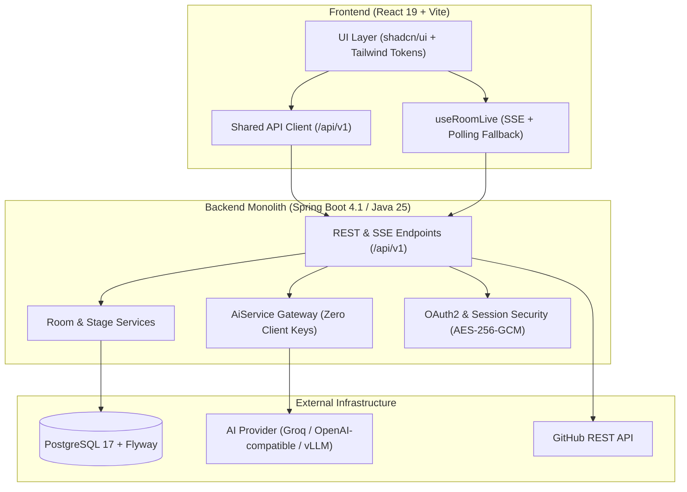

# [brackit]

[brackit] is an opinionated execution operating system and real-time team-room platform for hackathons. It guides teams step-by-step through Brief intake, Ideation, 5-step Planning, sprint Building (Kanban board, MVP studio, Docs vault), Tech integration (GitHub syncing, API catalog), Pitch delivery (Deck links, demo video, rehearsal timers, Q&A prep), and final Review and room archiving—backed by real-time Server-Sent Events (SSE), versioned concurrency protection, and a centralized, zero-client-key backend AI gateway.

---

## Architecture Sketch



---

## Prerequisites

- **Java Development Kit (JDK)**: Version 25 (or 21+)
- **Node.js**: Version 20+ (with npm 10+)
- **Docker & Docker Compose**: For containerized Postgres and full-stack runs
- **Git**: For source versioning

---

## Quickstart

### Option A: One-Click Docker Stack
```bash
docker compose up -d
```
Access the application at `http://localhost:5173` (or `http://localhost` if using the Nginx proxy bundle).

### Option B: Manual Local Setup

1. **Start PostgreSQL**:
   ```bash
   docker run --name hackathon-postgres -e POSTGRES_DB=hackathon_os -e POSTGRES_USER=postgres -e POSTGRES_PASSWORD=postgres -p 5432:5432 -d postgres:17
   ```

2. **Run Backend (port 8080)**:
   ```bash
   cd backend
   ./mvnw clean spring-boot:run -Dspring-boot.run.profiles=dev
   ```

3. **Run Frontend (port 5173)**:
   ```bash
   cd frontend
   npm install
   npm run dev
   ```

---

## Environment Variables

All variables default safely in development; see [.env.example](file:///.env.example) for container defaults:

| Variable | Description | Default / Example |
|---|---|---|
| `SPRING_PROFILES_ACTIVE` | Active Spring profile (`dev`, `prod`, `test`) | `dev` |
| `SPRING_DATASOURCE_URL` | PostgreSQL JDBC connection URL | `jdbc:postgresql://localhost:5432/hackathon_os` |
| `SPRING_DATASOURCE_USERNAME` | Database username | `postgres` |
| `SPRING_DATASOURCE_PASSWORD` | Database password | `postgres` |
| `APP_SECURITY_ENCRYPTION_KEY` | 32-char AES-256 encryption secret for tokens | `0123456789abcdef0123456789abcdef` |
| `AI_BASE_URL` | Base URL for LLM provider gateway | `https://api.groq.com/openai/v1` |
| `AI_API_KEY` | Server-only API key (never sent to client) | `gsk_...` |
| `AI_MODEL_DEFAULT` | Default model identifier | `llama-3.3-70b-versatile` |
| `AI_MODEL_FAST` | Fast model for summaries and naming | `llama-3.1-8b-instant` |
| `AI_JSON_MODE_SUPPORTED` | Flag if LLM provider supports JSON mode | `true` |
| `VITE_API_BASE_URL` | Frontend API client base URL | `http://localhost:8080` |

---

## Enabling Dev Seed Data

To populate sample rooms, tasks, documents, and members for testing:
1. Start the backend with the `dev` profile active (`-Dspring-boot.run.profiles=dev`).
2. Call the idempotent seed endpoint:
   ```bash
   curl -X POST http://localhost:8080/api/v1/dev/seed -H "Content-Type: application/json"
   ```
3. Or visit `/dev/flow` directly while running the frontend in Vite development mode.

---

## AI Provider Configuration (Rule 13: Zero Client Keys)

All AI interactions are routed strictly through the backend `AiService` gateway:
- **No secrets in frontend**: The browser never receives or stores LLM keys. No `VITE_*` variable holds an AI secret.
- **Provider Swapping**: Change `AI_BASE_URL`, `AI_API_KEY`, and `AI_MODEL_*` in backend `.env` to route through Groq, OpenAI, or local vLLM/SGLang instances. See [docs/AI_PROVIDERS.md](file:///docs/AI_PROVIDERS.md) for full configuration specs.
- **Health Verification**: Check current backend AI status in Settings > AI Status or via `GET /api/v1/ai/status`.

---

## Project Structure

```text
hackathon-os/
├── backend/                   # Spring Boot monolith (Java 25)
│   └── src/main/java/com/hackathonos/backend/
│       ├── ai/                # AiService gateway, status, and prompts
│       ├── rooms/             # RoomService, RoomStageService, RoomTimeService
│       ├── tasks/             # Kanban board, tasks, comments, dependencies
│       ├── docs/              # Markdown vault, versioning, exports
│       ├── members/           # Roster, roles, join codes, leave flows
│       └── common/            # Error handling, idempotency, security
├── frontend/                  # React 19 + TypeScript (Vite)
│   └── src/
│       ├── app/               # Routes, shell layouts, top bar, navigation
│       ├── design/            # Tokens, UI components, live hooks, spot illustrations
│       ├── features/          # Room domains: brief, ideate, plan, board, docs, summary
│       └── services/          # Typed API clients calling /api/v1
└── docs/                      # Technical specifications, checklists, and guides
```

---

## Common Problems & Troubleshooting

- **Missing Encryption Key (`APP_SECURITY_ENCRYPTION_KEY`)**: If the backend fails to start with an encryption error, ensure `APP_SECURITY_ENCRYPTION_KEY` is set to an exact 32-character string in your environment.
- **Uploads Directory Permissions**: If document or attachment uploads fail, ensure the working user has write access to the configured upload folder (defaults to `./uploads` in dev).
- **OAuth Callback URL Mismatch**: If Google or GitHub login redirects to an error, verify that `http://localhost:8080/login/oauth2/code/{provider}` is registered in your OAuth provider app console.
