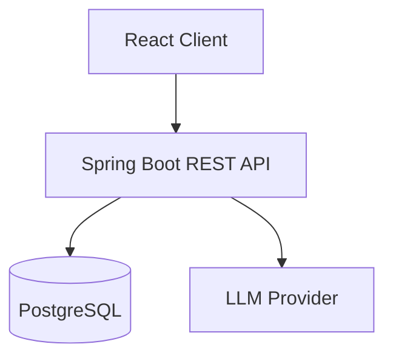

# Tech stack

| Layer | Choice | Why | Team knows it? |
| --- | --- | --- | --- |
| Frontend | React + Vite | Fast HMR and lightweight | Known |
| Backend | Spring Boot 4 | Robust transaction isolation and Flyway | Known |
| Database | PostgreSQL | ACID compliance and JSONB querying | Known |
| Styling | TailwindCSS | Rapid prototyping with atomic utility tokens | Known |

# Architecture

The system follows a modular architecture separating brief intake, ideation, and multi-step plan orchestration.

# New-tech risks
- Deep learning LLM token cost: mitigate with client-side prompt caching and character limits.
