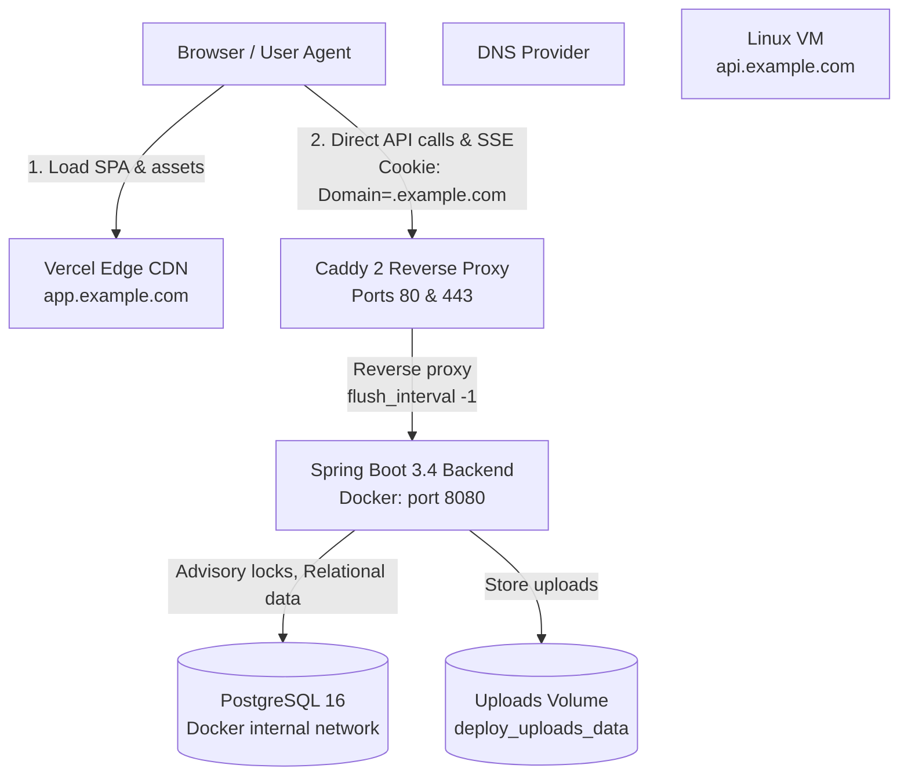
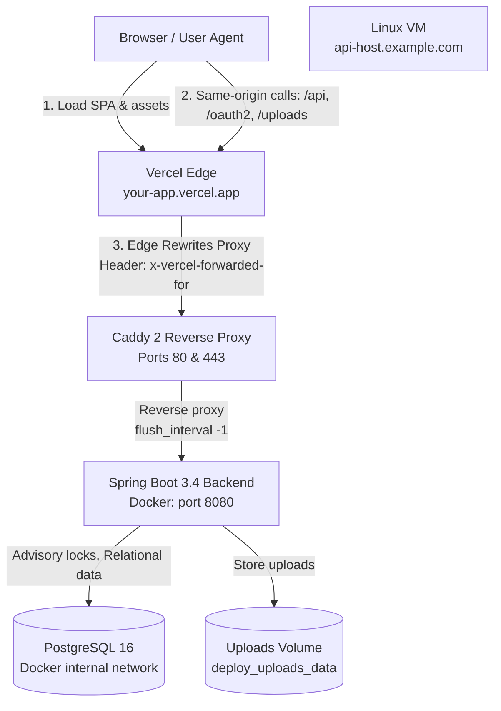

# Production Deployment Guide: [brackit]

This guide covers production deployment of [brackit] on a single Linux VM (Docker Compose with PostgreSQL 16, Spring Boot backend, and Caddy 2 for HTTPS) serving a frontend hosted on Vercel.

---

## 1. Architecture Overview

[brackit] supports two distinct deployment modes configured entirely via environment variables.

### Mode A (Recommended: Shared Registrable Domain)

The frontend is served at `https://app.example.com` and the backend is served at `https://api.example.com`. Both origins share the root cookie domain `.example.com`.



### Mode B (Single Origin / Vercel Rewrites)

When no custom domain is available, Vercel hosts the frontend (e.g., `https://brackit.vercel.app`) and proxies `/api`, `/oauth2`, `/login/oauth2`, and `/uploads` directly to the backend VM. The browser communicates with a single origin using host-only cookies.



---

## 2. Prerequisites

1. **Linux VM**: Ubuntu 22.04 or 24.04 LTS (x86_64 or ARM64 Ampere A1). Minimum 2 vCPU, 4 GB RAM.
2. **Ports**: Inbound traffic on ports `80` (HTTP ACME challenge) and `443` (HTTPS) permitted in cloud security groups.
3. **Domain Name**: A custom domain for Mode A (e.g., `example.com`), or a public IP/hostname for Mode B.
4. **Vercel Account**: For frontend hosting.
5. **OAuth 2.0 Credentials**: GitHub OAuth App and Google Cloud OAuth Client ID & Secret.
6. **Gmail Account**: With 2-Step Verification and a 16-character App Password.

---

## 3. Step-by-Step VM Setup

### Step 3.1: Run Host Provisioning Script
SSH into your Ubuntu server as `root` or `sudo` user and run the idempotent setup script:
```bash
# Upload or curl setup-vm.sh to the server
chmod +x setup-vm.sh
sudo ./setup-vm.sh
```

This script:
- Configures Oracle/Ubuntu iptables to allow ports 80 and 443 before default reject rules.
- Installs Docker Engine, `containerd`, and the Docker Compose plugin.
- Allocates a 2 GB swap file to prevent OOM issues.
- Creates deploy user `deploy` and sets up `/opt/hackathon-os` and `/opt/hackathon-os/backups`.
- Enables automated security updates (`unattended-upgrades`).

### Step 3.2: Clone Project and Configure Environment
Switch to the `deploy` user and clone the repository:
```bash
sudo su - deploy
cd /opt/hackathon-os
git clone <your-repository-url> .
```

Copy the example environment configuration:
```bash
cp deploy/backend.env.example deploy/backend.env
chmod 600 deploy/backend.env
nano deploy/backend.env
```

Populate all required variables (see [Section 6](#6-environment-variables-reference)).

### Step 3.3: Launch Stack
From `/opt/hackathon-os/deploy`:
```bash
docker compose -f docker-compose.prod.yml up -d
```

Verify status:
```bash
docker compose -f docker-compose.prod.yml ps
docker compose -f docker-compose.prod.yml logs -f backend
```

---

## 4. DNS Configuration

### Mode A (Custom Subdomains)
| Type  | Name | Target / Value | TTL | Note |
|---|---|---|---|---|
| `A` | `api.example.com` | `YOUR_VM_PUBLIC_IP` | 300 | Direct to Caddy reverse proxy |
| `CNAME` | `app.example.com` | `cname.vercel-dns.com` | 300 | Managed by Vercel |

### Mode B (Vercel Origin Only)
| Type  | Name | Target / Value | TTL | Note |
|---|---|---|---|---|
| `A` | `backend.example.com` | `YOUR_VM_PUBLIC_IP` | 300 | Backend destination for Vercel rewrites |

---

## 5. Vercel Project Settings & Rewrites

### Mode A
- **Framework Preset**: Vite
- **Root Directory**: `frontend`
- **Environment Variables**:
  ```ini
  VITE_API_BASE_URL=https://api.example.com
  ```

### Mode B
- **Framework Preset**: Vite
- **Root Directory**: `frontend`
- **Environment Variables**:
  ```ini
  VITE_API_BASE_URL=
  ```
  *(Leave empty so the frontend makes relative calls like `/api/v1/...`)*
- **Rewrites (`frontend/vercel.json`)**:
  ```json
  {
    "rewrites": [
      {
        "source": "/api/:path*",
        "destination": "https://backend.example.com/api/:path*"
      },
      {
        "source": "/oauth2/:path*",
        "destination": "https://backend.example.com/oauth2/:path*"
      },
      {
        "source": "/login/oauth2/:path*",
        "destination": "https://backend.example.com/login/oauth2/:path*"
      },
      {
        "source": "/uploads/:path*",
        "destination": "https://backend.example.com/uploads/:path*"
      }
    ]
  }
  ```

---

## 6. OAuth Provider Settings

OAuth callback URLs are derived strictly from `API_PUBLIC_URL` using `/login/oauth2/code/{provider}`.

| Provider | Mode A Redirect URI | Mode B Redirect URI |
|---|---|---|
| **GitHub** | `https://api.example.com/login/oauth2/code/github` | `https://app.example.com/login/oauth2/code/github` |
| **Google** | `https://api.example.com/login/oauth2/code/google` | `https://app.example.com/login/oauth2/code/google` |

> [!IMPORTANT]
> In Mode B, the redirect URI uses the frontend domain (`app.example.com`) because Vercel proxies `/login/oauth2/code/*` to Caddy and the backend.

---

## 7. Environment Variables Reference

| Variable | Required in Prod | Mode A Example | Mode B Example | Description |
|---|:---:|---|---|---|
| `API_HOST` | Yes | `api.example.com` | `backend.example.com` | Hostname served by Caddy |
| `APP_PUBLIC_URL` | Yes | `https://app.example.com` | `https://app.example.com` | Web frontend public URL |
| `API_PUBLIC_URL` | Yes | `https://api.example.com` | `https://app.example.com` | Public entry point for API & OAuth |
| `COOKIE_DOMAIN` | Mode A | `.example.com` | *(empty)* | Scope for auth & CSRF cookies |
| `CORS_ALLOWED_ORIGINS`| Yes | `https://app.example.com` | `https://app.example.com` | Allowed browser origins |
| `POSTGRES_USER` | Yes | `hackathon` | `hackathon` | PostgreSQL username |
| `POSTGRES_PASSWORD` | Yes | `strong-random-pw` | `strong-random-pw` | PostgreSQL password |
| `POSTGRES_DB` | Yes | `hackathon_os` | `hackathon_os` | PostgreSQL database name |
| `APP_ENCRYPTION_KEY` | Yes | `64-char-hex-key` | `64-char-hex-key` | AES-256-GCM master key |
| `GITHUB_CLIENT_ID` | Yes | `Iv1.xxx` | `Iv1.xxx` | GitHub OAuth client ID |
| `GITHUB_CLIENT_SECRET`| Yes | `ghs_xxx` | `ghs_xxx` | GitHub OAuth client secret |
| `GOOGLE_CLIENT_ID` | Yes | `xxx.apps.googleusercontent.com` | `xxx.apps.googleusercontent.com` | Google OAuth client ID |
| `GOOGLE_CLIENT_SECRET`| Yes | `GOCSPX-xxx` | `GOCSPX-xxx` | Google OAuth client secret |
| `MAIL_HOST` | Yes | `smtp.gmail.com` | `smtp.gmail.com` | SMTP relay server |
| `MAIL_PORT` | Yes | `587` | `587` | SMTP port |
| `MAIL_USERNAME` | Yes | `notifications@example.com` | `notifications@example.com` | SMTP username |
| `MAIL_PASSWORD` | Yes | `16-char-app-password` | `16-char-app-password` | SMTP App password |
| `MAIL_FROM` | Yes | `notifications@example.com` | `notifications@example.com` | Email sender address |
| `ADMIN_EMAILS` | Yes | `admin@example.com` | `admin@example.com` | Comma-separated admin emails |
| `SUPPORT_EMAIL` | Yes | `support@example.com` | `support@example.com` | Support email address |
| `AI_PLATFORM_FALLBACK`| Yes | `false` | `false` | Must be false in production |
| `CLIENT_IP_HEADER` | No | `x-vercel-forwarded-for` | `x-vercel-forwarded-for` | Trusted IP header from edge proxy |
| `APP_USER_CAP` | No | `1000` | `1000` | User account limit (0 = unlimited) |

---

## 8. Maintenance Workflows

### 8.1 Updating the Stack
To deploy a new release zero-downtime:
```bash
/opt/hackathon-os/deploy/update.sh
```
This script pulls the repository, builds the new Docker image, retags the existing image as `:previous`, performs `docker compose up -d`, waits for readiness, and logs recent entries.

### 8.2 Rolling Back
If an update encounters errors:
```bash
/opt/hackathon-os/deploy/rollback.sh
```
Restores the `:previous` container image immediately and verifies readiness.

### 8.3 Backups
Backups run automatically via daily cron at 02:00 UTC:
```bash
/opt/hackathon-os/deploy/backup.sh
```
Retains the 7 newest database dumps (`db_*.dump`) and uploads archives (`uploads_*.tar.gz`) in `/opt/hackathon-os/backups`.

### 8.4 Restoring from Backup
See full instructions in [deploy/restore.md](file:///c:/Users/Admin/.antigravity/hackathon-os/deploy/restore.md).

---

## 9. Troubleshooting

### 1. Cookies Not Sent by Browser
- **Cause**: Cookie domain mismatch or missing `credentials: 'include'`.
- **Resolution**:
  - In Mode A, ensure `COOKIE_DOMAIN=.example.com` (note the leading dot) and both frontend and backend use HTTPS (`Secure` cookies are ignored over plain HTTP).
  - In Mode B, ensure `COOKIE_DOMAIN` is completely empty so cookies are host-only.
  - Verify that the frontend API client includes `credentials: 'include'` on cross-origin requests.

### 2. OAuth Redirect URI Mismatch
- **Cause**: Google or GitHub rejected the callback URL.
- **Resolution**:
  - The redirect URI registered in the provider console must match:
    `${API_PUBLIC_URL}/login/oauth2/code/{provider}`
  - Ensure `server.forward-headers-strategy=framework` is enabled in `application.yml` (already configured) so Spring Boot recognizes Caddy's `X-Forwarded-Proto: https`.

### 3. SSE Not Streaming / Buffered
- **Cause**: Proxies buffering response chunks before sending to the client.
- **Resolution**:
  - Caddy is configured with `flush_interval -1` for the backend proxy block, ensuring SSE chunks are immediately pushed to the client.
  - In Mode B, if Vercel buffers the stream, verify response headers contain `Content-Type: text/event-stream`, `Cache-Control: no-cache, no-transform`, and `X-Accel-Buffering: no`.

### 4. Mail Authentication Failure (535 Authentication Failed)
- **Cause**: Invalid password or regular account password used instead of an App Password.
- **Resolution**:
  - Generate an App Password in Google Account Settings: Security -> 2-Step Verification -> App passwords.
  - Ensure `MAIL_STARTTLS_ENABLE=true` and port is `587`.
  - Check Spring Boot startup log: `Mail service configured with host: smtp.gmail.com`.

### 5. PostgreSQL Connection Refused
- **Cause**: Backend attempted to connect before PostgreSQL accepted connections, or wrong host configured.
- **Resolution**:
  - Docker Compose defines `depends_on: postgres: condition: service_healthy`. PostgreSQL uses `pg_isready` healthcheck.
  - Ensure `SPRING_DATASOURCE_URL` specifies `jdbc:postgresql://postgres:5432/...` (referencing the Docker service name `postgres`, not `localhost`).
