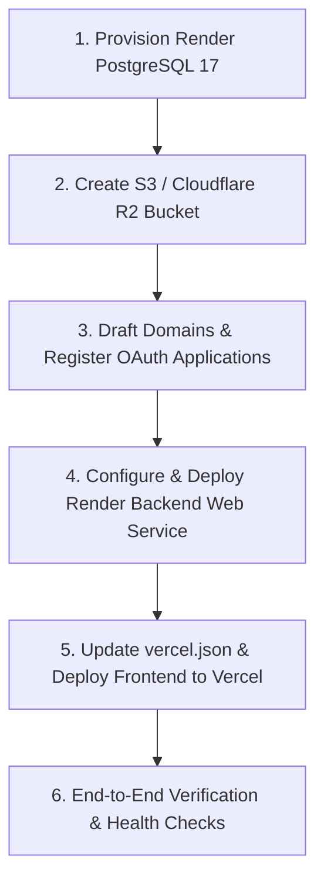

# Production Deployment Checklist (Steps 1–8)

**Target Topology:**
- **Frontend:** Vercel Edge Network (`https://<VERCEL_DOMAIN>`)
- **Backend:** Render Web Service (`https://<RENDER_HOST>.onrender.com`)
- **Database:** Render Managed PostgreSQL 17 (Flyway `V1`–`V47`)
- **Object Storage:** Cloudflare R2 / AWS S3 (Bucket: `bracket-uploads`)

---

## 1. Environment Variables Added or Changed in Steps 1–8

The table below lists every environment variable introduced, updated, or re-configured during Steps 1 through 8.

| Name | Required in Prod? | Default | What It Does | Example Value |
|---|:---:|---|---|---|
| `DB_POOL_SIZE` | **Yes** | `10` | Maximum HikariCP JDBC connections per backend instance. Must not exceed managed Postgres `max_connections - headroom` divided by instances. | `10` |
| `AI_MAX_CONCURRENT` | No | `6` | Global concurrency bulkhead permit limit for outbound LLM requests to prevent thread and memory saturation. | `6` |
| `STT_MAX_CONCURRENT` | No | `3` | Global concurrency bulkhead permit limit for Whisper Speech-to-Text transcription requests. | `3` |
| `HEAVY_PARSE_MAX_CONCURRENT` | No | `2` | Global concurrency bulkhead permit limit for PDFBox and Apache POI parsing of uploaded documents. | `2` |
| `BULKHEAD_ACQUIRE_TIMEOUT_MS` | No | `5000` | Milliseconds to wait to acquire a bulkhead permit before failing fast with HTTP 503 (`SERVER_BUSY`). | `5000` |
| `PDF_MAX_PAGES` | No | `80` | Maximum pages extracted from an uploaded PDF document before rejecting/truncating to prevent out-of-memory. | `80` |
| `PPTX_MAX_SLIDES` | No | `60` | Maximum slides extracted from an uploaded PowerPoint deck before rejecting/truncating to protect memory. | `60` |
| `SESSION_TIMEOUT` | No | `8h` | Sliding inactivity expiration window for Spring Session stored in PostgreSQL (`SPRING_SESSION`). | `8h` |
| `STORAGE_PROVIDER` | **Recommended** | `local` | Storage driver (`local` for ephemeral container disk, `s3` for AWS S3 / Cloudflare R2 / MinIO). In prod, `local` logs a severe warning because avatars are wiped on container restart. | `s3` |
| `S3_ENDPOINT` | **Conditional** (Yes if `STORAGE_PROVIDER=s3`) | *empty* | Custom S3 API endpoint. Required for Cloudflare R2 or MinIO; leave empty for standard AWS S3. | `https://<account-id>.r2.cloudflarestorage.com` |
| `S3_REGION` | No | `us-east-1` | S3 bucket region (`auto` for Cloudflare R2, standard AWS region otherwise). | `auto` |
| `S3_BUCKET` | **Conditional** (Yes if `STORAGE_PROVIDER=s3`) | *empty* | Target S3 bucket name for avatars and exported pitch decks. | `bracket-uploads` |
| `S3_ACCESS_KEY` | **Conditional** (Yes if `STORAGE_PROVIDER=s3`) | *empty* | S3 API Access Key ID or Cloudflare R2 Token ID. | `0123456789abcdef0123456789abcdef` |
| `S3_SECRET_KEY` | **Conditional** (Yes if `STORAGE_PROVIDER=s3`) | *empty* | S3 API Secret Access Key or Cloudflare R2 Secret. | `secret_key_abcdef1234567890...` |
| `S3_PATH_STYLE` | No | `false` | Enables path-style bucket addressing. Set `false` for AWS S3 and Cloudflare R2; set `true` for MinIO. | `false` |
| `SSE_MAX_STREAMS_PER_USER` | No | `6` | Maximum concurrent Server-Sent Events (SSE) connections allowed per user across tabs/devices before evicting the oldest stream with a `bye` event. | `6` |
| `EVENTS_BUS` | No | `local` | Real-time event bus engine (`local` for single-container in-memory dispatch; `postgres` for multi-instance cluster fanout via PostgreSQL `LISTEN/NOTIFY`). | `postgres` |
| `PROXY_SHARED_SECRET` | No | *empty* | Shared secret matched against incoming `x-proxy-secret` header. Allows backend to trust upstream reverse proxy headers (`x-vercel-forwarded-for`) and prevents IP spoofing. | `a9f4e2...` (32+ hex chars) |
| `METRICS_TOKEN` | **Yes** | *empty* | Secret Bearer token required to scrape `/actuator/prometheus` in production. Requests without `Authorization: Bearer <METRICS_TOKEN>` receive HTTP 403. | `met_live_83920af817b3c4...` |
| `SENTRY_DSN` | No | *empty* | Backend Sentry DSN for exception telemetry and slow transaction tracing. Backend sanitizes PII before sending. | `https://abcd@o1234.ingest.sentry.io/5678` |
| `VITE_SENTRY_DSN` | No | *empty* | Frontend Sentry DSN for browser error tracking. Strips auth headers and sensitive parameters in `beforeSend`. | `https://efgh@o1234.ingest.sentry.io/9012` |
| `MAIL_PROVIDER` | No | `smtp` | Mail transport implementation (`smtp` for Gmail/SMTP server, `resend` for Resend REST API, `log` for local test logging). | `resend` |
| `RESEND_API_KEY` | **Conditional** (Yes if `MAIL_ENABLED=true` & `MAIL_PROVIDER=resend`) | *empty* | API token for Resend HTTPS email dispatch. Validated by `ProductionStartupValidator`. | `re_1234567890abcdef` |
| `SPRING_PROFILES_ACTIVE` | **Yes** | `dev` | Active Spring Boot profile. Must be set to `prod`. Strictly guarded by `LoadtestProfileGuard` to prevent accidental `loadtest` execution in production. | `prod` |
| `LOADTEST_MEM_LIMIT` | No (Load Test Only) | `512M` | Container memory cgroup ceiling in `docker-compose.loadtest.yml`. | `1024M` |
| `LOADTEST_CPU_LIMIT` | No (Load Test Only) | `0.5` | Container CPU cgroup quota in `docker-compose.loadtest.yml`. | `1.0` |
| `MOCK_AI_DELAY_MIN_MS` | No (Load Test Only) | `15000` | Minimum simulated response delay (ms) in mock LLM server. | `15000` |
| `MOCK_AI_DELAY_MAX_MS` | No (Load Test Only) | `40000` | Maximum simulated response delay (ms) in mock LLM server. | `40000` |

### Core Baseline Production Variables Checked by `ProductionStartupValidator`

In addition to the variables above, `ProductionStartupValidator` runs at startup under `@Profile("prod")` and will abort startup with a fatal error if any of the following baseline variables are missing or set to placeholder/localhost values:

| Baseline Variable | Validation Rule | Example Value |
|---|---|---|
| `DB_HOST`, `DB_NAME`, `DB_USERNAME`, `DB_PASSWORD` | Must connect to remote PostgreSQL (no `localhost:5433` or `hackathon` user/pass) | Render Managed PostgreSQL Credentials |
| `APP_ENCRYPTION_KEY` | Must be $\ge 16$ characters, non-placeholder (recommended: 32 bytes / 64 hex characters via `openssl rand -hex 32`) | `7b2d5a81...` |
| `GITHUB_CLIENT_ID`, `GITHUB_CLIENT_SECRET` | Required; cannot equal `dummy-github-client-id` or placeholder | `Ov23li...` |
| `GOOGLE_CLIENT_ID`, `GOOGLE_CLIENT_SECRET` | Required; cannot equal `dummy-google-client-id` or placeholder | `102938...apps.googleusercontent.com` |
| `APP_PUBLIC_URL` | Must start with `http` and cannot contain `localhost` | `https://<VERCEL_DOMAIN>` |
| `API_PUBLIC_URL` | Must start with `http` and cannot contain `localhost` | `https://<RENDER_HOST>.onrender.com` |
| `ADMIN_EMAILS`, `SUPPORT_EMAIL` | Required; must contain valid `@` email address | `admin@hackathon-os.dev` |
| `AI_PLATFORM_FALLBACK` | **Must be `false`** (server pays for zero AI usage in prod; users BYOK via Settings > AI) | `false` |

---

## 2. Exact OAuth Callback URLs to Register

All OAuth callbacks point to the frontend domain `<VERCEL_DOMAIN>` (e.g. `https://bracket-app.vercel.app`), **not** directly to the backend Render host.

> **Why?**
> The Vercel frontend reverse proxies `/login/oauth2/*` and `/api/*` to Render via `frontend/vercel.json`. Using the frontend origin as the callback URL guarantees that session cookies (`JSESSIONID`) remain first-party, preventing browser cookie drop due to Safari ITP and Chrome third-party cookie restrictions.

Register the following exact URLs in their respective developer consoles:

| Provider | Purpose | Console Location | Exact Callback URL to Register |
|---|---|---|---|
| **GitHub OAuth Login** | User Sign-in & Authentication | GitHub Developer Settings $\rightarrow$ OAuth Apps $\rightarrow$ *Your Login App* $\rightarrow$ **Authorization callback URL** | `https://<VERCEL_DOMAIN>/login/oauth2/code/github` |
| **GitHub Link App** | In-Room Repo Sync & Commits Link | GitHub Developer Settings $\rightarrow$ OAuth Apps $\rightarrow$ *Your Repo Link App* $\rightarrow$ **Authorization callback URL** | `https://<VERCEL_DOMAIN>/api/v1/github/link/callback` |
| **Google OAuth Login** | User Sign-in & Authentication | Google Cloud Console $\rightarrow$ APIs & Services $\rightarrow$ Credentials $\rightarrow$ *OAuth 2.0 Client IDs* $\rightarrow$ **Authorized redirect URIs** | `https://<VERCEL_DOMAIN>/login/oauth2/code/google` |
| **Canva Integration** | Presentation & Pitch Deck Export | Canva Developer Portal $\rightarrow$ Your App $\rightarrow$ Authentication $\rightarrow$ **Redirect URLs** | `https://<VERCEL_DOMAIN>/api/v1/integrations/canva/callback` |

---

## 3. Exact Order to Deploy

Deploying in the proper sequence ensures database migrations apply cleanly, OAuth redirect URIs match live domains, and proxy rewrites resolve without 502/404 errors.



### Step 1: Provision Managed PostgreSQL 17 on Render
1. Create a **PostgreSQL** instance on Render (Starter or Standard tier, PostgreSQL 17).
2. Note the internal and external database credentials:
   - `DB_HOST`, `DB_PORT` (default `5432`), `DB_NAME`, `DB_USERNAME`, `DB_PASSWORD`.
3. Check max connections: Render Starter typically provides 97 max connections. Set target pool size to `10`.

### Step 2: Create S3 / Cloudflare R2 Bucket
1. In Cloudflare Dashboard, navigate to **R2 Object Storage** $\rightarrow$ **Create Bucket**:
   - Bucket Name: `bracket-uploads`.
2. Generate an **API Token** with `Object Read & Write` permissions:
   - Note the `Endpoint URL` (`https://<account-id>.r2.cloudflarestorage.com`), `Access Key ID`, and `Secret Access Key`.
   - Set region to `auto`.

### Step 3: Plan Canonical Domains & Register OAuth Apps
1. Determine your planned production domains:
   - Frontend Domain: `<VERCEL_DOMAIN>` (e.g. `bracket-app.vercel.app` or custom domain).
   - Backend Domain: `<RENDER_HOST>.onrender.com` (e.g. `bracket-api.onrender.com`).
2. Register the 4 OAuth callback URLs in GitHub, Google, and Canva consoles exactly as specified in Section 2.
3. Save the resulting Client IDs and Client Secrets:
   - `GITHUB_CLIENT_ID`, `GITHUB_CLIENT_SECRET`
   - `GOOGLE_CLIENT_ID`, `GOOGLE_CLIENT_SECRET`
   - *(Optional)* `GITHUB_LINK_CLIENT_ID`, `GITHUB_LINK_CLIENT_SECRET`
   - *(Optional)* `CANVA_CLIENT_ID`, `CANVA_CLIENT_SECRET`

### Step 4: Configure and Deploy the Backend Web Service on Render
1. In Render Dashboard, click **New +** $\rightarrow$ **Web Service**.
2. Connect your Git repository (`backend/` root or repository root using Dockerfile).
3. Set the service plan:
   - Standard Plan (1GB RAM / 1 CPU or 2GB RAM / 2 CPU) is recommended for load resilience.
4. Configure all environment variables in Render:
   - Set `SPRING_PROFILES_ACTIVE=prod`.
   - Set `PORT=10000`.
   - Set `APP_PUBLIC_URL=https://<VERCEL_DOMAIN>`.
   - Set `API_PUBLIC_URL=https://<RENDER_HOST>.onrender.com`.
   - Set database credentials (`DB_HOST`, `DB_PORT`, `DB_NAME`, `DB_USERNAME`, `DB_PASSWORD`).
   - Set `DB_POOL_SIZE=10`.
   - Set `APP_ENCRYPTION_KEY` (generate with `openssl rand -hex 32`).
   - Set OAuth credentials for GitHub and Google.
   - Set `STORAGE_PROVIDER=s3` and `S3_*` credentials from Step 2.
   - Set `METRICS_TOKEN` to a secure random string.
   - Set `ADMIN_EMAILS` and `SUPPORT_EMAIL`.
   - Set `AI_PLATFORM_FALLBACK=false`.
   - Set `COOKIE_SECURE=true` and `COOKIE_SAME_SITE=Lax`.
   - Set `EVENTS_BUS=postgres` (or `local` if single container).
5. Trigger Deployment.
6. Verify startup logs:
   - Confirm Flyway executes migrations up to `V47__performance_indexes.sql`.
   - Confirm `ProductionStartupValidator` logs `Production configuration validation passed successfully.`
   - Confirm shallow health probe responds:
     ```bash
     curl -i https://<RENDER_HOST>.onrender.com/api/v1/health
     # Expected: HTTP 200 {"status":"ok"}
     ```
   - Confirm readiness probe responds:
     ```bash
     curl -i https://<RENDER_HOST>.onrender.com/api/v1/health/ready
     # Expected: HTTP 200 {"status":"UP","database":"UP"}
     ```

### Step 5: Update `frontend/vercel.json` and Deploy Frontend on Vercel
1. In `frontend/vercel.json`, verify the rewrite destinations point to your Render host:
   ```json
   {
     "rewrites": [
       { "source": "/api/:path*", "destination": "https://<RENDER_HOST>.onrender.com/api/:path*" },
       { "source": "/oauth2/:path*", "destination": "https://<RENDER_HOST>.onrender.com/oauth2/:path*" },
       { "source": "/login/oauth2/:path*", "destination": "https://<RENDER_HOST>.onrender.com/login/oauth2/:path*" },
       { "source": "/uploads/:path*", "destination": "https://<RENDER_HOST>.onrender.com/uploads/:path*" },
       { "source": "/(.*)", "destination": "/index.html" }
     ]
   }
   ```
2. Commit and push the updated `vercel.json`.
3. In Vercel Project Settings:
   - Root Directory: `frontend`
   - Build Command: `npm run build`
   - Output Directory: `dist`
   - Environment Variables:
     - `VITE_API_BASE_URL`: **Leave empty** (so client makes same-origin relative requests proxied by Vercel).
     - *(Optional)* `VITE_SENTRY_DSN`: Set if using client-side Sentry error tracking.
4. Trigger production deploy on Vercel.

### Step 6: Post-Deployment Smoke Test
1. Visit `https://<VERCEL_DOMAIN>`.
2. Verify the login page loads; click **Sign in with GitHub** or **Google**.
3. Verify successful OAuth redirection, account creation, and landing on Dashboard.
4. Inspect DevTools cookies: confirm `JSESSIONID` is present with `HttpOnly`, `Secure`, and `SameSite=Lax`.
5. Navigate to **Settings** $\rightarrow$ **Profile** and upload an avatar. Verify the avatar renders from `/uploads/avatars/...` (served from R2/S3).
6. Open a room in two separate tabs/browsers: verify real-time SSE updates (`/api/v1/rooms/{id}/events`) and presence indicators work without disconnect loops.
7. Scrape metrics securely:
   ```bash
   curl -H "Authorization: Bearer <METRICS_TOKEN>" https://<RENDER_HOST>.onrender.com/actuator/prometheus
   # Expected: HTTP 200 with Prometheus text output
   ```

---

## 4. Which Variables Can Be Safely Skipped

The following variables can be safely omitted or left blank without crashing `ProductionStartupValidator` or breaking core app functionality:

### 1. Outgoing Mail (`MAIL_*` and `RESEND_API_KEY`)
- **Safe to Skip:** Set `MAIL_ENABLED=false` (the default).
- **Why:** When `MAIL_ENABLED=false`, `ProductionStartupValidator` bypasses all mail validation. The application functions completely; emails are simply not sent, and notifications are delivered via the in-app notification center.
- **Can skip:** `MAIL_HOST`, `MAIL_PORT`, `MAIL_USERNAME`, `MAIL_APP_PASSWORD`, `MAIL_FROM_ADDRESS`, `MAIL_FROM_NAME`, `MAIL_REPLY_TO`, `RESEND_API_KEY`.

### 2. Optional Third-Party Integrations
- **Safe to Skip:**
  - `CANVA_CLIENT_ID` and `CANVA_CLIENT_SECRET`: Canva export button will indicate unconfigured, but core pitch deck builder functions normally.
  - `APP_GITHUB_TOKEN`, `GITHUB_LINK_CLIENT_ID`, `GITHUB_LINK_CLIENT_SECRET`: Only required if teammates want to connect a custom GitHub OAuth App to sync room repos. Not required for basic GitHub OAuth login.
  - `APP_GITHUB_USE_FAKE`: Defaults to `false`.

### 3. Sentry Error Telemetry (`SENTRY_DSN` and `VITE_SENTRY_DSN`)
- **Safe to Skip:** Leave empty.
- **Why:** Both the Spring Boot backend (`SentryService`) and React frontend (`sentry.ts`) check if the DSN is non-empty before initializing. If empty, the Sentry SDK remains completely dormant with zero runtime overhead or warnings.

### 4. Reverse Proxy Shared Secret (`PROXY_SHARED_SECRET`)
- **Safe to Skip:** Leave empty.
- **Why:** If unset, `ClientIpResolver` safely falls back to extracting the rightmost untrusted hop in `X-Forwarded-For` and the socket `remoteAddr`. Rate limiting and auditing remain fully functional.

### 5. Server-Side AI API Keys (`AI_API_KEY`, `AI_PLATFORM_KEY`, `STT_API_KEY`)
- **Safe to Skip:** Leave empty on Render.
- **Why:** Brackit enforces a strict **Bring Your Own Key (BYOK)** model in production. Users supply their own Groq API key in **Settings $\rightarrow$ AI**. In production, `AI_PLATFORM_FALLBACK` must be `false` so the platform incurs zero AI API costs. `STT_API_KEY` is only needed if you choose to sponsor pitch rehearsal speech-to-text.

### 6. Event Bus Clustering (`EVENTS_BUS`)
- **Safe to Skip:** Omit to use the default `EVENTS_BUS=local`.
- **Why:** If running a single backend container on Render, `LocalEventBus` handles all room event dispatching in memory. Only set `EVENTS_BUS=postgres` if scaling to 2 or more backend container instances.

### 7. File Storage S3 Variables (Only if using ephemeral storage)
- **Can Skip:** `S3_ENDPOINT`, `S3_REGION`, `S3_BUCKET`, `S3_ACCESS_KEY`, `S3_SECRET_KEY`, `S3_PATH_STYLE` if `STORAGE_PROVIDER=local`.
- **Trade-off:** `ProductionStartupValidator` will log a loud warning because avatars uploaded to local disk are lost when Render restarts or redeploys the container. (For persistent storage, set `STORAGE_PROVIDER=s3`).

### 8. Concurrency Bulkhead & Limit Overrides
- **Safe to Skip:** `AI_MAX_CONCURRENT`, `STT_MAX_CONCURRENT`, `HEAVY_PARSE_MAX_CONCURRENT`, `BULKHEAD_ACQUIRE_TIMEOUT_MS`, `PDF_MAX_PAGES`, `PPTX_MAX_SLIDES`, `SSE_MAX_STREAMS_PER_USER`, `SESSION_TIMEOUT`.
- **Why:** All of these variables have battle-tested production defaults built directly into `application.yml` and `application-prod.yml`. You only need to define them if you need to fine-tune limits under specific load conditions.

### 9. Load Testing & Mock Variables
- **Safe to Skip:** `LOADTEST_MEM_LIMIT`, `LOADTEST_CPU_LIMIT`, `MOCK_AI_DELAY_MIN_MS`, `MOCK_AI_DELAY_MAX_MS`.
- **Why:** These are strictly used by `docker-compose.loadtest.yml` and the local mock LLM server. They have no effect in production.

