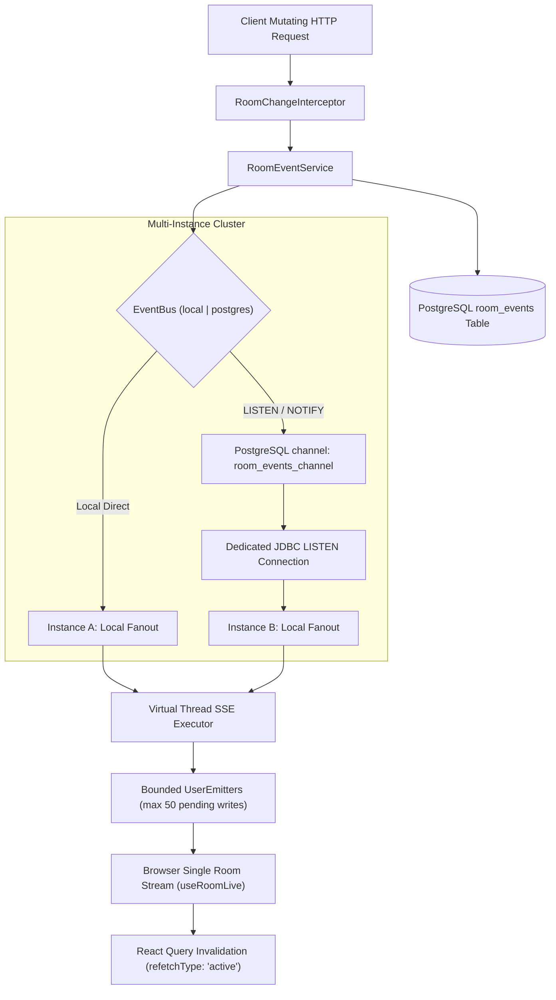
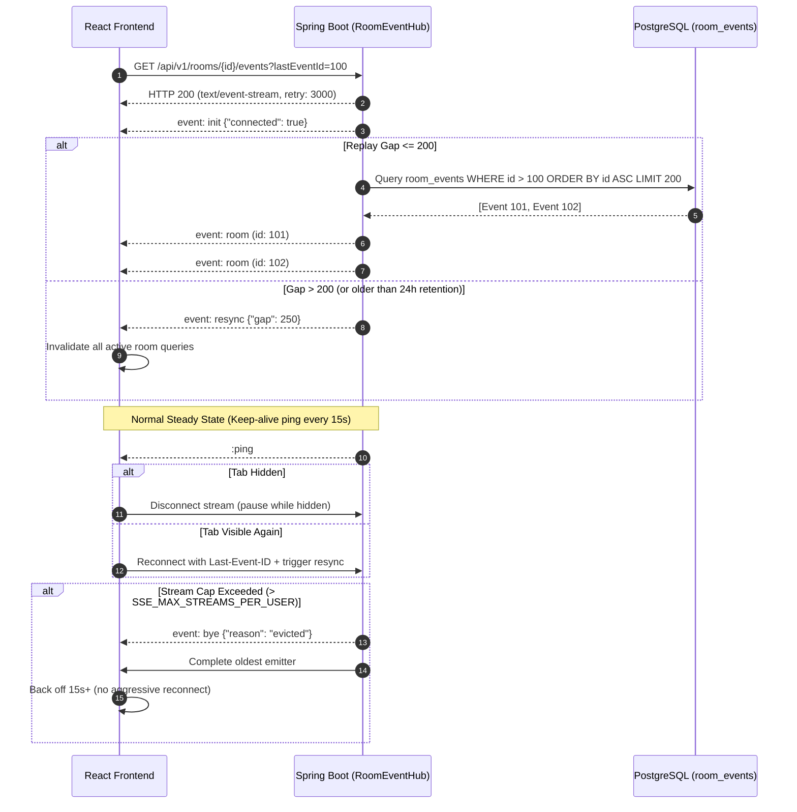

# Real-Time Architecture (SSE)

This document describes the real-time Server-Sent Events (SSE) streaming engine in Bracket (Hackathon OS), detailing the event publication pipeline, client connection lifecycle, durable event replay, presence tracking, and multi-instance clustering.

---

## 1. High-Level Architecture & Event Pipeline

The server emits lightweight signals when state changes. Frontend clients invalidate and refetch active React Query caches, avoiding WebSocket complexity while achieving sub-second UI updates.



---

## 2. Client Connection Lifecycle & Replay Protocol

Each browser tab maintains strictly **one** SSE room stream managed by `useRoomLive` in `LiveContext`. Personal notifications use a separate dedicated stream via `useNotificationStream`.



---

## 3. Presence Tracking & Cleanup

Presence is recorded via database-backed heartbeat upserts every 60s, eliminating in-memory node-affinity issues.

1. **Heartbeat Endpoint**: `POST /api/v1/rooms/{roomId}/presence/heartbeat` (or `/presence`) updates `room_presence(room_id, user_id, last_seen)`.
2. **Active Window**: A user is considered online if `last_seen >= NOW() - INTERVAL '90 SECONDS'`.
3. **Response Shape**: `GET /api/v1/rooms/{roomId}/presence/members` returns:
   ```json
   {
     "online": ["06be82bb-253c-4ce1-8631-0df8bcfe0d01", "1a2b3c4d-5e6f-7a8b-9c0d-1e2f3a4b5c6d"]
   }
   ```
4. **Pruning Job**: `CleanupJob` runs an hourly PostgreSQL advisory-locked task (lock ID `1005L`) deleting:
   - `room_events` older than 24 hours.
   - `room_presence` records older than 24 hours.

---

## 4. Multi-Instance Scaling (PostgreSQL LISTEN/NOTIFY)

When running behind a load balancer on Render with multiple container instances:

- Set `EVENTS_BUS=postgres` (default is `local`).
- Each container starts a single background worker on dedicated JDBC connection executing `LISTEN room_events_channel`.
- When an event occurs on Instance A, it executes `SELECT pg_notify('room_events_channel', '<payload>')`.
- Instance B receives the async notification, maps or queries the durable event, and fans it out across local subscribers using virtual threads.
- If PostgreSQL LISTEN drops, the listener reconnects with a 3-second backoff loop while logging clean diagnostics.

---

## 5. Diagnostic Endpoint

An administrative diagnostic endpoint is exposed for health audits:
- **`GET /api/v1/admin/realtime/stats`** (Requires admin role)
- Returns:
  ```json
  {
    "activeRooms": 3,
    "totalRoomStreams": 12,
    "totalNotificationStreams": 8,
    "busType": "PostgresNotifyEventBus",
    "rooms": [
      {
        "roomId": "e2e9c158-b11a-47d0-8f92-9118c7c94541",
        "activeSubscribers": 4,
        "uniqueOnlineUsers": 3,
        "bufferedEvents": 50
      }
    ]
  }
  ```

