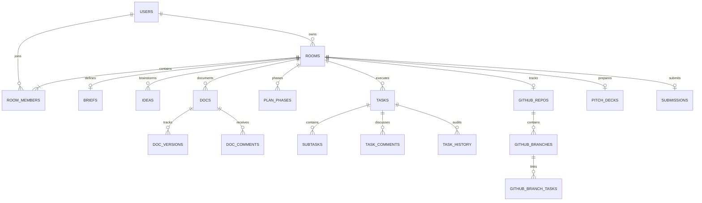

# Database Architecture & Operations Guide

## Overview

Hackathon OS relies on PostgreSQL 16+ as its single source of truth, managed via sequential, idempotent Flyway migrations (`V1` through `V9`). The database models multi-tenant hackathon workspaces with real-time planning, execution boards, GitHub synchronization, pitch decks, and submission verification.

---

## 1. Entity-Relationship Model



---

## 2. Migration History

| Version | Migration File | Focus Area |
| :--- | :--- | :--- |
| `V1` | `V1__phase1_schema.sql` | Core domain: `users`, `rooms`, `room_members`, `invites`, `notifications` |
| `V2` | `V2__seed_event_templates.sql` | Preset hackathon templates (24h sprint, 48h campus, 7d async) |
| `V3` | `V3__phase2_planning.sql` | Planning module: `briefs`, `ideas`, `plan_steps`, `plan_phases`, `docs`, `tasks` |
| `V4` | `V4__event_template_aliases.sql` | Event template alias mapping |
| `V4_1`| `V4_1__phase3_build.sql` | Execution: optimistic locking on `tasks`, `mvp_state`, `room_checkpoints` |
| `V5` | `V5__phase4_tech.sql` | Technical layer: `github_repos`, `github_branches`, `api_hub`, `diagrams` |
| `V6` | `V6__phase4_present_review.sql` | Deliverables: `pitch_decks`, `rehearsals`, `submissions`, `retros` |
| `V7` | `V7__phase4_catalog_hidden.sql` | Catalog visibility and feature toggle persistence |
| `V8` | `V8__seed_catalog.sql` | Catalog seed data |
| `V9` | `V9__phase5_hardening.sql` | Performance FK indexes, constraints, `set_updated_at()` automated trigger |

---

## 3. Indexing Strategy

1. **Foreign Key Performance Indexes**:
   - Every column referencing a parent table (`room_id`, `user_id`, `actor_id`, `phase_id`, `task_id`) has an explicit B-tree index in `V9__phase5_hardening.sql`. This prevents full-table sequential scans during join operations and cascaded deletes.
2. **Composite Filtering & Ordering Indexes**:
   - `tasks (room_id, status, position)`: Accelerates Kanban swimlane queries.
   - `activity_events (room_id, created_at DESC)`: Speeds up live room timeline rendering.
   - `notifications (user_id, read_at, created_at DESC)`: Powers the unread notifications badge and inbox.
   - `ideas (room_id, status, created_at)`: Instant filtering for silent voting and triage stages.
3. **Unique Partial Constraints**:
   - Single primary idea per room: `UNIQUE INDEX idx_ideas_single_primary ON ideas (room_id) WHERE is_primary = true`.
   - Single leader per room: `UNIQUE INDEX uq_room_members_leader ON room_members (room_id) WHERE role = 'LEADER'`.

---

## 4. Trigger & Timestamp Governance

All mutable state entities use the `set_updated_at()` trigger function defined in `V9`:
```sql
CREATE OR REPLACE FUNCTION set_updated_at()
RETURNS TRIGGER AS $$
BEGIN
    NEW.updated_at = now();
    RETURN NEW;
END;
$$ LANGUAGE plpgsql;
```
Triggers automatically refresh `updated_at` before every row update on `rooms`, `tasks`, `docs`, `ideas`, `briefs`, `user_settings`, `github_repos`, `github_branches`, `mvp_state`, and `pitch_decks`.

---

## 5. Automated Maintenance & Cleanup Job

The `CleanupJob` runs every night at `03:00 UTC` via Spring's `@Scheduled`:
- **Expired Invites**: Deletes rows in `invites` where `expires_at < now()`.
- **Old Notifications**: Deletes read notifications older than 30 days (`read_at IS NOT NULL AND created_at < now() - INTERVAL '30 days'`).
- **Expired Exports**: Purges generated data exports whose TTL has elapsed.

---

## 6. Backup & Restore Procedures

### Database Backup
- **Bash / Linux / macOS**:
  ```bash
  ./scripts/db-backup.sh
  ```
- **PowerShell / Windows**:
  ```powershell
  ./scripts/db-backup.ps1
  ```
  Produces a timestamped dump under `./backups/hackathon_os_YYYYMMDD_HHMMSS.sql.gz`.

### Database Restore
- **Bash / Linux / macOS**:
  ```bash
  ./scripts/db-restore.sh ./backups/hackathon_os_YYYYMMDD_HHMMSS.sql.gz
  ```
- **PowerShell / Windows**:
  ```powershell
  ./scripts/db-restore.ps1 -BackupFile ./backups/hackathon_os_YYYYMMDD_HHMMSS.sql
  ```
