# 3. Architecture & Components

## 3.1 Runtime Components Inventory
| Component | Runtime / Engine | Port / Protocol | Deployment Unit | Description |
|---|---|---|---|---|
| **Frontend SPA** | React 19 / Vite | Port 443 (HTTPS) | Vercel Edge CDN | Client application with client-side routing, React Query cache, and LiveContext SSE listeners |
| **Backend API Monolith** | Spring Boot 4.1.1 / Java 25 | Port 10000 (Render) / 8080 (Local) | Render Web Service Docker Container | Central API, auth, business logic, SSE streaming hub, and task runner |
| **PostgreSQL Database** | PostgreSQL 17 | Port 5432 (TCP) | Render PostgreSQL Managed Instance | 116 relational tables, Flyway migrations, JSONB columns, advisory locks |
| **MCP Companion Server** | Node.js 20+ / Express | Port 3001 (HTTP) | Standalone Node Process | Model Context Protocol server exposing Brackit tools to IDEs and agents via `/mcp` |
| **In-Memory SSE Hub** | `RoomEventHub.java` | HTTP Streaming (SSE) | Embedded inside Spring JVM | Holds active SSE connections, 200-event ring buffer, monotonic sequence generator |
| **In-Memory SSE Broadcaster** | `RoomSseBroadcaster.java` | HTTP Streaming (SSE) | Embedded inside Spring JVM | Legacy/secondary broadcaster holding active SSE emitters for `/stream` |
| **Background Job Scheduler** | Spring `@Scheduled` Pool | Internal JVM Threads (pool size: 4) | Embedded inside Spring JVM | Runs 13 periodic background jobs synchronized via PostgreSQL session advisory locks |
| **Email Outbox Worker** | `MailWorker.java` | SMTP TLS (Port 587) | Embedded inside Spring JVM | Polls `email_outbox` every 5 seconds and delivers via Gmail SMTP or dry-run log |
| **AI Gateway** | `AiService.java` | HTTPS REST (outbound) | Outbound HTTP Client | Proxies Groq / OpenAI LLM endpoints with rate limiting, circuit breaking, and user key overrides |
| **Whisper STT Client** | `AiClient.java` (STT) | HTTPS REST (outbound) | Outbound HTTP Client | Transcribes rehearsal audio clips via Groq Whisper (`whisper-large-v3`) |
| **GitHub Integration** | `RestGitHubClient.java` | HTTPS REST (outbound) | Outbound HTTP Client | Syncs branches, commits, pull requests, and commit frequency |
| **Canva Integration** | `CanvaService.java` | HTTPS REST (outbound) | Outbound HTTP Client | Connects user Canva designs to pitch deck via OAuth PKCE |
| **Ephemeral File Storage** | Local Container Filesystem | `/app/uploads` | Local Docker Volume | Stores user avatars. **Ephemeral on Render without persistent disk.** |

## 3.2 System Architecture Diagram

```mermaid
graph TD
    subgraph Browser ["User Browser (Client)"]
        ReactApp["React 19 SPA (Client Shell)"]
        LiveCtx["LiveContext (SSE /api/v1/rooms/{id}/events)"]
        QueryCache["TanStack Query (staleTime: 5m)"]
        ZustandStores["Zustand (Drafts, UI, Auth)"]
    end

    subgraph Edge ["CDN / Reverse Proxy"]
        VercelCDN["Vercel Edge Network"]
        VercelRewrites["Vercel Path Rewrites (/api, /oauth2, /uploads)"]
    end

    subgraph BackendHost ["Render Container: hackathon-os-backend (Single JVM Process)"]
        Tomcat["Tomcat Servlet Engine (maxThreads: 200)"]
        SecurityFilter["Spring Security FilterChain (Order 1: MCP, Order 2: Session/CSRF)"]
        ReqIdFilter["RequestIdFilter (MDC Correlation)"]
        RateLimitInt["RateLimitInterceptor (Global Unauth IP + Bucket)"]
        RoomChangeInt["RoomChangeInterceptor (150ms Mutating Event Trigger)"]
        
        subgraph Controllers ["Controllers & Services"]
            RoomSvc["Room & Stage Services"]
            TaskSvc["Task & Board Services"]
            DocSvc["Docs Vault Service"]
            PitchSvc["PitchKit & Rehearsal Services"]
            ApiHubSvc["ApiHub & Mock Services"]
            AdminSvc["Admin & AppSettings Services"]
        end

        subgraph InProcessState ["In-Memory Process State (Lost on Restart / Multi-Instance)"]
            EventHub["RoomEventHub (Emitters, RingBuffer[200], Sequences)"]
            RateLimitMap["RateLimiter (TokenBucket Map)"]
            AiLimiterMap["AiRateLimiter & Concurrency Semaphores"]
            PresenceMap["PresenceService (User Presence Map)"]
            HttpSessionStore["Tomcat StandardSessionManager (JSESSIONID)"]
        end

        subgraph Schedulers ["Background Tasks (pool-size: 4)"]
            AdvisoryLock["DbAdvisoryLockService (pg_try_advisory_lock)"]
            MailWorkerJob["MailWorker (every 5s, lock 1004)"]
            SyncJob["GitHubSyncJob (every 10m, lock 1007)"]
            ReminderJob["DeadlineReminderJob (every 5m, lock 1005)"]
            RetentionJob["DataRetentionJob (3 AM, lock 1001)"]
            PingJob["RoomEventHub Ping (every 25s)"]
        end
    end

    subgraph DatabaseHost ["Render Managed PostgreSQL 17"]
        HikariPool["HikariCP Pool (max-size: 5, min-idle: 1)"]
        Postgres[(PostgreSQL DB: hackathon_os - 116 Tables)]
        FlywayMigrations["44 Flyway Migrations (V1..V43)"]
        AdvisoryLocksTable["PostgreSQL Session Advisory Locks"]
    end

    subgraph ExternalServices ["External Third-Party APIs"]
        GroqLLM["Groq / OpenAI API (LLM Generation)"]
        GroqWhisper["Groq Whisper API (STT Transcription)"]
        GitHubAPI["GitHub REST API"]
        GmailSMTP["Gmail SMTP Server (smtp.gmail.com:587)"]
        CanvaAPI["Canva Connect OAuth API"]
    end

    ReactApp --> LiveCtx
    ReactApp --> QueryCache
    QueryCache --> VercelCDN
    LiveCtx --> VercelCDN
    VercelCDN --> VercelRewrites
    VercelRewrites --> Tomcat
    
    Tomcat --> ReqIdFilter
    ReqIdFilter --> SecurityFilter
    SecurityFilter --> RateLimitInt
    RateLimitInt --> Controllers
    Controllers --> RoomChangeInt
    RoomChangeInt --> EventHub
    EventHub -.->|Push SSE| LiveCtx

    Controllers --> HikariPool
    HikariPool --> Postgres
    Schedulers --> AdvisoryLock
    AdvisoryLock --> Postgres
    MailWorkerJob --> GmailSMTP

    Controllers --> GroqLLM
    PitchSvc --> GroqWhisper
    Controllers --> GitHubAPI
    Controllers --> CanvaAPI
```

## 3.3 Monolith vs Services & Process Boundaries
- **Backend Architecture**: The backend is a **modular monolith** running entirely inside a single operating system process (JVM) on Render. There are no separate worker processes or microservices.
- **MCP Companion Process**: The `brackit-mcp-server` is a standalone Node.js process designed to run on a developer machine or as a secondary service, connecting back to the Spring Boot REST API via Bearer token auth (`/api/v1/mcp/**`).

## 3.4 In-Memory State Held by the Server Process
The server process holds substantial mutable state in heap memory. **This is the single biggest architectural barrier to horizontal scaling (running 2+ instances) and causes data/session loss upon container restart or free-tier sleeping:**

| State Holder | Class / Location | Data Structure | Scope / Description | Scalability Impact if Multi-Instance |
|---|---|---|---|---|
| **Room SSE Emitters** | `RoomEventHub.java:38` | `ConcurrentHashMap<UUID, List<UserEmitter>>` | Active Server-Sent Events HTTP connections per room | **CRITICAL**: If User A connects to Instance 1 and User B connects to Instance 2, events on Instance 1 will NEVER reach User B. |
| **User Notification Emitters** | `RoomEventHub.java:39` | `ConcurrentHashMap<UUID, List<SseEmitter>>` | Active personal notification streams per user | **CRITICAL**: Notification events published on another instance are dropped. |
| **Monotonic Room Sequences** | `RoomEventHub.java:40` | `ConcurrentHashMap<UUID, AtomicLong>` | Per-room sequence number counter (`seq`) | **CRITICAL**: Independent sequence numbers on different nodes cause duplicate IDs and broken replay. |
| **Event Ring Buffers** | `RoomEventHub.java:41` | `ConcurrentHashMap<UUID, Deque<RoomEvent>>` | Recent 200 events per room for reconnection replay | Reconnection replay only works if the client reconnects to the exact same instance. |
| **Secondary SSE Emitters** | `RoomSseBroadcaster.java:29` | `ConcurrentHashMap<UUID, List<EmitterEntry>>` | Emitters for `/stream` endpoint | Divergent in-memory list; events published via `RoomSseBroadcaster` miss `RoomEventHub`. |
| **User Presence Registry** | `PresenceService.java:18` | `ConcurrentHashMap<UUID, Map<UUID, Instant>>` | Map of `roomId -> userId -> lastSeen` | Users on different instances cannot see each other online. |
| **HTTP User Sessions** | Tomcat `StandardSessionManager` | In-memory session table (`JSESSIONID`) | Authentication and login session data | **HIGH**: Container sleep/restart logs out all users. Multiple instances require sticky sessions or fail auth. |
| **Rate Limiter Buckets** | `RateLimiter.java:16` | `ConcurrentHashMap<String, TokenBucket>` | Token buckets for unauth IP limits and `@RateLimited` | Limits are per-instance; round-robin traffic doubles allowed request quotas. |
| **Event Burst Deduplication**| `RoomChangeInterceptor.java:29`| `ConcurrentHashMap<String, Long>` | 150ms timestamp cache per `roomId:topic:entityId` | Deduplication is per-instance only. |
| **AI Circuit Breaker** | `AiCircuitBreaker.java:19` | `AtomicInteger consecutiveFailures`, `AtomicBoolean open` | 3 consecutive failures opens circuit breaker for 30s | State not shared; one instance may be open while another calls the failing AI endpoint. |
| **AI User Rate Limiter** | `AiRateLimiter.java:23` | `ConcurrentHashMap<UUID, Deque<Instant>>` | 10 calls per minute sliding window per user | Users can bypass AI rate limits by hitting multiple instances. |
| **AI Concurrency Limiters** | `AiService.java:47` | `ConcurrentHashMap<UUID, Semaphore>` | Max 4 concurrent LLM calls per user | Users can exceed concurrency limits across instances. |
| **GitHub Section Cache** | `GitHubService.java:64` | `ConcurrentHashMap<String, CacheEntry<?>>` | 60-second in-memory cache of GitHub stats | Cache misses occur across instances; double API requests. |
| **Join Attempt Limiter** | `JoinAttemptLimiter.java:15` | `ConcurrentHashMap<String, AttemptTracker>` | 5 attempts per 15 minutes for room join codes | Brute force protection is weakened across multiple nodes. |
| **Rehearsal Audio Limits** | `RehearsalService.java:64` | `ConcurrentHashMap<UUID, Integer>` | Max 30 audio chunk uploads per rehearsal run | Quotas are not enforced consistently across instances. |
| **Username Change Limiter** | `UserService.java:915` | `ConcurrentHashMap<UUID, List<Long>>` | 3 username changes per hour | Bypassed if routed to another node. |
